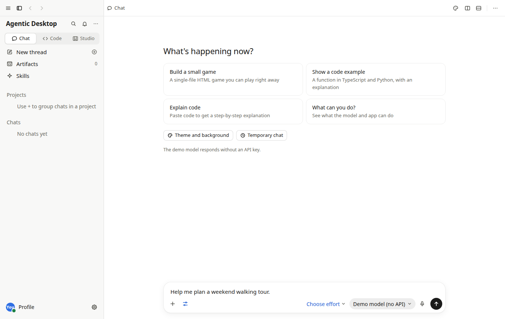
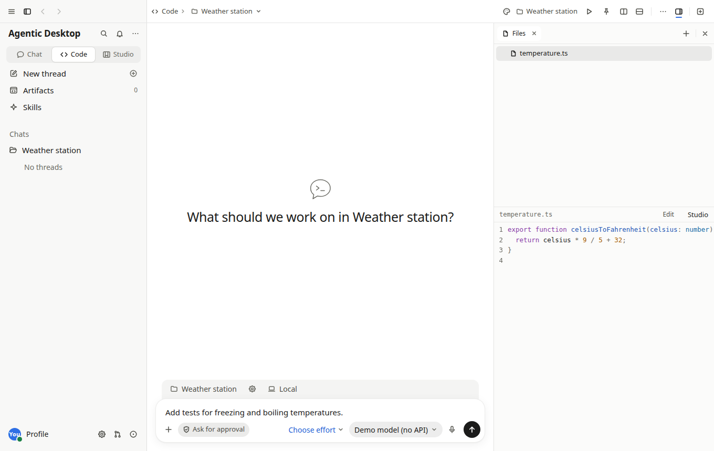
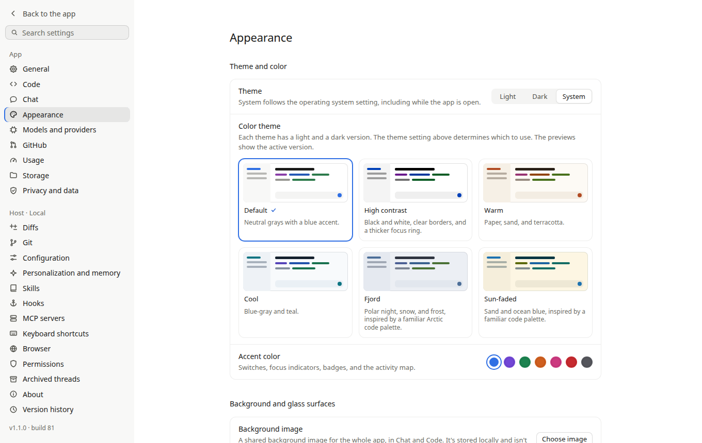

# Agentic Desktop

[Norsk versjon (README.nb.md)](README.nb.md) · [Download latest release](https://github.com/bejulian1/agentic-desktop/releases/latest) · [Changelog](CHANGELOG.md) · [Credits](CREDITS.md)

> Norwegian Bokmål is the source language. Settings → General → Language switches the translated screens live. All eleven translation catalogs cover the UI; user content stays in its original language.

Agentic Desktop is a local-first Linux desktop application (Electron + Node.js + SolidJS) for chatting and coding with large language models using **your own API keys** or local models. Talk to models in **Chat**, or hand them a folder in **Code** (`Kode`) where the agent can read and edit files, run terminal commands, and inspect what it builds in an integrated browser. Conversations, projects, and settings are stored locally in SQLite—no Agentic Desktop account, no telemetry, and a built-in demo model lets you explore the interface and tools without an API key.

Agentic Desktop is open source under the [MIT License](LICENSE). The current release is **v1.4.0 (build 86)**.

| Chat workspace | Code workspace | Appearance settings |
| --- | --- | --- |
| [](docs/bilder/en/chat.png) | [](docs/bilder/en/kode.png) | [](docs/bilder/en/appearance.png) |

*Click a screenshot for full size. These views use temporary demo data and predate some of the 1.2–1.3 settings pages.*

## What's New in 1.2.0 – 1.4.0

- **Simple Code-Focus workspace & customizable chrome (v1.4.0).** Under **Settings → Appearance → Workspace (`Arbeidsflate`)**, switch in one click between **Full** and **Simple (Code focus)**—or toggle **Minimal top bar**, **Split-pane buttons**, **Simple sidebar**, and **Simple composer** individually. Search, notifications, and `⋯` move up into the sidebar top bar on wide screens, and `[project icon] Project / Thread` breadcrumbs lead the title.
- **Resizable bottom terminal drawer (v1.4.0).** Press **Ctrl+J** (**⌘J** on Mac) or use the top-bar drawer icon to open a multi-tab, drag-resizable terminal right below the composer. Tabs start in your project, active worktree, or home folder, and stay alive when hidden.
- **Auto-colored & auto-detected project icons + two-line Code rows (v1.4.0).** Projects without a manual color get a consistent palette color automatically, and `findFavicon()` detects icons declared in `index.html`, web manifests, `package.json` (`build.icon`), and common desktop/web icon folders. Code sidebar rows display title + age on line 1, and project icon, branch/local, linked `#N` PR badge, and colored model mark directly under the age on line 2.
- **Actionable thread inbox & `/grill-me` skill (v1.4.0).** Under **Settings → Appearance → Inbox and triage**, choose between project lists and a prioritized **Inbox list**, hide background running threads in a collapsible **Working** fold, configure optional auto-settling on inactivity or when a linked GitHub PR closes/merges, snooze with presets or a custom wake time (`Ctrl+Alt+Z`, `/snooze`, `/settle`), and wake snoozed threads automatically on new activity. Includes the built-in `/grill-me` interactive design-interview skill in both Chat and Code.

- **Permissions that stick.** "Allow always" on simple commands (`git status`, `npm test`, `npx tsc`, …) saves a prefix rule; chains, pipes, redirects, and risky programs still need an exact match, and protected paths always prompt. One rule covers all `browser_*` tools. **Settings → Permissions** lists saved rules and has **Apply to all projects** for the default mode.
- **Appearance and Typography.** 11 color themes with light and dark variants checked against WCAG AA: Standard, Ocean, Pink, Forest, Ember, Iris, High contrast, Warm, Cool, Fjord, and Sun-faded. **Settings → Appearance** adds System/Light/Dark cards, an interface contrast slider, conversation width, a math toggle, and **Typography** pickers for interface and code fonts with live previews.
- **Settings → Projects.** Always available, with a selector for **No project (This machine)**, Code projects, Archived projects, and Chat projects. Code projects get an icon picker (Icons, Emoji, Monogram, 18 colors, your own file, or the project favicon), pin, archive/restore, default model and thinking effort, workspace mode (current checkout or new Git worktree), permissions and browser access, **Actions** (saved project scripts with optional `Mod`/`Alt` shortcuts, runnable from Settings, Thread details, or automatically when a new worktree is created), Checkouts, and `.agentic/AGENTS.md`.
- **Thread details (`Ctrl+Shift+D`).** A floating panel in Code with the project folder, **Open in VS Code**, project Actions, the active Git branch and worktree, live changes (`+N −M`), and subagents.
- **Rich links and colored marks.** Markdown and backtick file links (`api.ts:42`, `#L10-L20`) show colored file-type badges and open in the mini-editor at that line. `thread:<id>` links become thread chips, `$skill-name` becomes a skill chip, and every web link gets a colored inline-SVG mark—no external image requests. Provider and model marks appear in the model picker, sidebars, hover cards, model-switch dividers, answer model cards, thinking views, and subagent cards.
- **Providers and subagents.** The custom OpenAI-compatible form has **API address (Base URL)** and an optional **Model ID** field. Subagents can start on models from the same API provider, and switching models in an answered thread shows **Context handoff pending** with Undo.
- **GitHub pull requests and issues.** The GitHub CLI (`gh`) is detected automatically. When no local project has a GitHub remote—or when you pick it in the filter—**Mine on GitHub** lists pull requests and issues involving you (`@me`) across your account, with GitHub state colors and inline details, diffs, and comments.

See the [full changelog](docs/PATCHLOG.md) (Norwegian) for every change.

## Features

- **Welcome and history import.** Set up models and bring local projects and conversations from Claude Code, Codex CLI, Gemini CLI, and Pi. [Norwegian guide](docs/VELKOMST-OG-IMPORT.md)
- **[Kode Studio](docs/KODE-STUDIO.md):** Edit project files in tabs alongside the existing Code conversation, terminal, browser and diff. Studio keeps unsaved drafts when switching views and flags conflicting changes on disk.
- **Model questions:** Chat and Code can ask for single or multiple selections and free-text answers using [question cards](docs/USER-QUESTIONS.md).
- **Chat:** Streaming Markdown with code blocks, tables, and math; 8 personalities and 4 style controls ([Chat personalities](docs/CHAT-PERSONALITIES.md)); Chat projects with custom instructions and isolated or shared memories ([Chat projects](docs/CHAT-PROJECTS.md)); HTML and React (JSX/TSX) artifacts rendered in an isolated local sandbox with version history; downloadable documents (`.docx`, `.xlsx`, `.pptx`, Markdown, text, CSV, JSON) and optional sandboxed Python analysis via `bubblewrap` ([Files & Python in Chat](docs/CHAT-FILES.md)); plus `/btw` side questions, `/background` parallel sessions, and `/queue` / `/steer` delivery overrides ([Side questions & background sessions](docs/SIDE-QUESTIONS.md)).
- **Code agent (`Kode`) with tools and approvals:** Works inside a project folder with tools for reading, editing, creating, and deleting files, searching (`ripgrep`), running shell commands, web search/fetch, and browser automation. Includes three permission modes (**Ask**, **Accept edits**, **Full access**), read-only **Plan mode** (`/plan`), turn-level undo, local Git branch and worktree management (`/worktree`, [Git & tools](docs/GIT-AND-TOOLS.md)), bidirectional sub-agent instances with read receipts, and shortcuts `/agents`, `/diff`, `/context`, and `/stop` ([Instances & read receipts](docs/AGENT-COLLABORATION.md)).
- **This machine (`Denne datamaskinen`):** Work in Code without selecting a project—the agent uses your home directory as its workspace with standard approvals, per-rule "Allow always", and turn undo, while sensitive paths under your home directory always prompt and are excluded from search.
- **Side panels:** A shared tab bar for **Files** (with a mini-editor in projects and read-only browsing without a project), **Changes** (stacked or side-by-side line diffs with word highlights, whitespace toggle, colour-blind-friendly palette, and undo), **Terminal**, **Browser** (configurable search engine, agent access toggle with per-project overrides, link routing, default zoom, and appearance), **Session**, **Team**, and **GitHub**. The Browser supports element annotations and can open the active page in the system browser ([Side panel workspace](docs/SIDEPANEL-WORKSPACE.md)).
- **Terminal drawer.** In Code, press **Ctrl+J** (**⌘J** on Mac) to open a resizable terminal below the composer. Tabs start in the current project or worktree, or in your home directory on This machine. Hiding the drawer keeps its shells running.
- **GitHub:** Connect with GitHub CLI or a personal access token and browse pull requests and issues across projects—or across your whole account with **Mine on GitHub**—with details, checks, and diffs. The app does not write to GitHub ([GitHub guide in Norwegian](docs/GITHUB.md)).
- **MCP servers:** Built-in Model Context Protocol client supporting **stdio** and **Streamable HTTP** (`2025-11-25` and earlier), presets for GitHub and Playwright, secrets stored in the system keyring, per-tool approval, and up to 60 MCP tools per turn ([MCP servers](docs/MCP.md)).
- **Hooks:** Run your own shell commands on `PreToolUse`, `PostToolUse`, `UserPromptSubmit`, and `Stop` using a Claude Code-compatible JSON stdin/stdout contract, managed globally in Settings ([Hooks](docs/HOOKS.md)).
- **Commands and skills:** Type `/` for the active mode's commands and skills, `$` for skills only, or `/help` (alias `/commands`) for a searchable guide. Chat and Code share commands such as `/new`, `/sessions`, `/find`, and `/fork`. Code also has `/worktree` and project panel commands. Eight of the 25 built-in skills work in both modes, including `/grill-me` for working through a plan or design one decision at a time. Code-only examples include `/debug`, `/benchmark`, and `/ci-triage`. Add custom skills in a Code project's `.agentic/skills/` or in `~/.config/agentic-desktop/skills/` for Code and ordinary Chat. [Command and skill guide](docs/SLASH-SKILLS.md)
- **Thread inbox:** Choose a flat inbox under **Settings → Appearance** or keep your existing grouping. Snooze a thread to a preset or a custom time, settle it with `/settle`, or enable automatic archiving for inactive threads and linked pull requests that close or merge.
- **Inline charts:** Request a bar or line chart in Chat or Code. Charts render locally and do not require enabling Python or Artifacts.
- **Providers including local models:** Built-in presets for **OpenRouter**, **abliteration.ai**, **Anthropic**, **OpenAI**, and any **OpenAI-compatible** endpoint (Base URL plus your own model ID)—including local models via **Ollama** and **LM Studio** without an API key—plus the built-in **Demo model** (no network or API key required).
- **Themes & visual mods:** 11 color themes in light and dark, custom global wallpaper with opacity/blur and three glass styles, and per-conversation declarative visual mods (built-in Aurora, Starry Sky, and Ocean presets, or model-authored pixel-art and color themes with per-conversation consent and WCAG contrast validation) ([Themes & visual mods](docs/UI-MODS.md)).

More feature screenshots are available in the [Norwegian gallery](README.nb.md).

## Install

### AppImage and `.deb` (Linux x86_64)

Download prebuilt packages from [GitHub Releases](https://github.com/bejulian1/agentic-desktop/releases)—no GitHub account needed. Each release includes an **AppImage**, a **`.deb`**, `SHA256SUMS`, the full changelog (`VERSJONSLOGG.md`), and `RELEASEINFO.json` with version, build number, platform, and source commit. Builds are tested on Ubuntu 26.04.

```bash
sha256sum -c SHA256SUMS --ignore-missing   # verify the files you downloaded
chmod +x Agentic-Desktop-*-x86_64.AppImage && ./Agentic-Desktop-*-x86_64.AppImage
# or: sudo apt install ./agentic-desktop_*_amd64.deb
```

### Build and Install from Source

Requirements:
- Linux with GNOME (developed and tested on Ubuntu 26.04 on Wayland)
- **Node.js 26+** and npm
- Native build tools for `node-pty`: `sudo apt install build-essential python3`
- Recommended:
  - `ripgrep` (`rg`) for fast search and `@` file mentions
  - Google Chrome for web search and the browser panel when the Chromium sandbox is disabled
  - `bubblewrap` (`bwrap`) for optional isolated Python analysis in Chat

```bash
git clone https://github.com/bejulian1/agentic-desktop.git
cd agentic-desktop
./install.sh
```

`install.sh` checks prerequisites, runs `npm ci`, builds the frontend, packages the Electron app, and installs it for your user in `~/.local/opt/agentic-desktop` with a desktop entry and icon (no `sudo` required).

- **Update:** `git pull && ./install.sh` (your threads and settings in `~/.local/share/agentic-desktop` and `~/.config/agentic-desktop` are preserved).
- **Uninstall:** `./install.sh --uninstall` (user data is kept).

#### Optional: Chromium Sandbox Profile (Ubuntu 24.04+)

On Ubuntu systems that restrict unprivileged user namespaces, the launcher can fall back to starting Electron without its Chromium sandbox. In that mode the Browser panel uses separately sandboxed Google Chrome instead of an embedded Electron view. For a source install, you can load the bundled AppArmor profile to allow the Electron sandbox:

```bash
sudo install -m 644 ~/.local/opt/agentic-desktop/resources/apparmor/agentic-desktop /etc/apparmor.d/agentic-desktop
sudo apparmor_parser -r /etc/apparmor.d/agentic-desktop
```

## Quick Start

### Try Without an API Key (Demo Model)

The built-in **Demo-modell (uten API)** is selected by default. It does not call a model provider and exercises the real tools, diffs, approvals, and browser panel. Pick an empty folder in **Kode** and try prompts such as:

- `lag en side` — creates `index.html`, runs a command, opens it in the browser panel, and takes a screenshot
- `rediger` — edits `index.html` and shows a diff in Changes
- `godkjenning` — attempts to write `.env.demo` (always prompts for approval)
- `samarbeid` / `team` — demonstrates sub-agent threads and the team task list
- `/plan` then `lag en side` — runs in read-only Plan mode
- `react-artifact` / `html-spill` — creates interactive sandboxed artifacts
- `hjelp` — lists all demo prompts

### Connect a Real Provider or Local Model

1. Open **Innstillinger → Modeller og leverandører** (Settings → Models & Providers).
2. Choose **Koble til leverandør** to search the catalog or set up a custom endpoint. **Finn lokale servere** checks known local endpoints; **Anbefal modell** estimates which models fit your hardware. See the [provider guide](docs/PROVIDERS.md).
3. Enter a key if the provider needs one. The app uses the system keyring when available. Use **Test tilkobling** (Test connection), then select your model in the composer.

## Development

### Requirements

- Linux, **Node.js 26+** (`engines.node: >=26`), npm
- `build-essential` (`g++`, `make`) and `python3`
- Server and UI integration tests require `ripgrep`, working `bubblewrap` user namespaces, and Google Chrome. The Electron test runner also needs `xvfb-run` and `xauth`. See [the contributing guide](CONTRIBUTING.md#running-checks-and-tests) for build and test setup.

### Commands

| Command | Description |
| --- | --- |
| `npm ci` | Install dependencies |
| `npm start` | Build the UI if needed, then start the local server on port `4317` by default |
| `npm run typecheck` | Type-check `server/`, `web/`, and `desktop/` |
| `npm run test:server` | Run server unit and integration tests (`server/test/*.test.ts`) |
| `npm run test:ui` | Run UI end-to-end tests (`web/test/*.test.ts`) |
| `npm run test:desktop` | Run Electron desktop tests (`desktop/test/*.test.ts`) |
| `npm run build` | Build the web frontend and bump the build number in `version.json` |
| `npm run dist` | Package the Electron app to `dist-desktop/` (unpacked, `.deb`, AppImage) |
| `npm run install-local` | After `npm run dist`, install the package to `~/.local/opt/agentic-desktop` |

The server reserves its data directory until shutdown. Follow the [isolated development example](CONTRIBUTING.md#setup-and-run) to run alongside the installed app without sharing its data, configuration, keyring, or port.

### Tech Stack

- **Desktop:** Electron 45
- **Server:** Node.js 26+ running TypeScript directly (`node:sqlite`, `node-pty`, `playwright-core`, `ws`)
- **Frontend:** SolidJS + Vite, CodeMirror 6, xterm.js, React 19 (isolated artifact sandbox)

## Project Layout

```text
server/   Local Node.js server (HTTP/WebSocket API, SQLite store, agent runner, tools, providers, MCP, hooks)
web/      SolidJS + Vite frontend (Chat, Code, side panels, settings, artifact sandbox)
shared/   Shared TypeScript protocol and schema definitions (protocol, MCP, hooks, UI mods)
desktop/  Electron main/preload processes, native browser views, tray icon, AppArmor profile
skills/   Built-in slash-skills (skills/<name>/SKILL.md)
docs/     Architecture specs, feature guides, changelog (PATCHLOG.md), status notes, and screenshots
scripts/  Start, build, packaging (dist), local install, and test runner scripts
```

## Privacy and Security Model

- **Local storage, no telemetry:** Threads, projects, settings, and wallpapers stay on your machine (`~/.local/share/agentic-desktop` and `~/.config/agentic-desktop`). There is no Agentic Desktop account and no telemetry.
- **Network use:** The selected provider receives the prompt and any conversation context, attachments, and tool results needed for its response. Web tools, GitHub, and remote MCP servers make their own requests when used. Wallpapers are not sent to model providers.
- **Keys in the system keyring:** API keys, GitHub tokens, and secret MCP headers/environment variables are stored in the Linux Secret Service (GNOME Keyring via `libsecret`) when available, or in session memory only. Keys are never returned to the frontend UI, excluded from spawned shell/hook/browser environments, and redacted if echoed by an MCP server.
- **Approvals and protected paths:** Agent file modifications, commands, and MCP tool calls follow your chosen permission mode (**Ask**, **Accept edits**, or **Full access**). Protected paths—`.env*`, `.git/hooks`, `.git/config`, the app's own data/config directories, and sensitive home locations (`.ssh`, `.gnupg`, `.aws`, `.kube`, browser profiles, keyrings, shell history, etc.)—always require explicit approval and cannot be permanently auto-approved.
- **Important limitation:** Shell commands run by the coding agent execute as your Linux user. Command-line checks for protected paths are a best-effort text check, **not an OS sandbox**. Review requests carefully in untrusted repositories. Optional Chat Python uses `bubblewrap` without network or home directory access and with system libraries read-only.

See [SECURITY.md](SECURITY.md) for vulnerability reporting and full details.

## Contributing

Contributions are welcome! Please read [CONTRIBUTING.md](CONTRIBUTING.md) for setup instructions, coding conventions, how to write skills, and the pull request workflow, and follow our [Code of Conduct](CODE_OF_CONDUCT.md).

## Credits

**[bejulian1](https://github.com/bejulian1)** is the project owner and maintainer, responsible for product direction, design references, testing, and releases.

The project owner credits the following AI models for development assistance (see [CREDITS.md](CREDITS.md) for version-by-version details):

- **Anthropic Claude Opus 5.5** — used with Claude Code for the initial implementation through v0.11.0, sub-agent implementation, independent code reviews, and UI test maintenance. Coordinated the 1.0.0 and 1.1.0 releases, built PR #4 for 1.2.0 (prefix permissions, same-provider subagents, Base URL and model ID setup, context handoff indicator, pasted-image defaults, automatic `gh` detection), PR #7 and #8 for 1.3.0 (complete Projects settings, Actions, Typography, colored model marks, Mine on GitHub), and PR #9 for 1.3.1 (clickable file/thread links, web-link marks, `$skill` chips), plus a separate read-only `$review` and `$frontend-design` critique of 1.3.0 that led to the 1.3.1 fixes. Also updated this README, the Norwegian README, and CREDITS.md for 1.3.1.
- **Anthropic Claude Sonnet 5.5** — built PR #6 for 1.2.0: the Ocean, Pink, Forest, Ember, and Iris themes, contrast/width/math controls, the first Projects settings page, monogram and uploaded project icons, expanded favicons, smart link/file chips, inline GitHub detail view, and the floating Thread details panel.
- **Anthropic Claude Fable 5.2** — used with Claude Code from v0.24.1 onward (glass backgrounds, MCP servers, hooks, the v0.26.0 harness, built-in skills, Chat personalities, "This machine" mode without a project, and release packaging).
- **OpenAI GPT 6.1 Sol** — used with Codex and sub-agents for ongoing feature development, reviews, and fixes (including v0.11.0–v0.24.0, v0.27.0–v0.29.0, agent communication, and parent chains).
- **OpenAI GPT 6.2 Sol and GPT 6.2 Astra** — used with Codex for the command guide, skills, and conversation and project commands. Codex also implemented inline charts and reviewed and hardened the data-directory lock, reconnect behavior, and system-browser handoff. GPT 6.2 Sol built the 1.1.0 GitHub CLI integration, the welcome screen with project and conversation import, and the terminal drawer in Code.
- **Google Gemini** — contributed the initial data-directory reservation, history-reconnect fix, and system-browser action. **Gemini 4 Neon** finished Kode Studio, built the 1.1.0 diff, browser, notification, and sidebar settings, built the lighter Ocean theme and colored favicons in 1.2.1, and, working in Google Antigravity, coordinated 1.2.0–1.3.1: merging PRs, translating new text into all 11 locales, fixes and design polish after the 1.3.1 review, testing, release, and packaging.

GPT 6.2 Sol and GPT 6.2 Astra also contributed provider catalog entries, API compatibility, setup, and local model discovery and recommendations.

GPT 6.2 Astra implemented [dictation](docs/diktering.md) and [scheduled tasks](docs/planlagte-oppgaver.md) and removed nonfunctional controls.

Translations for 1.0.0: GPT 6.2 Sol translated English, Swedish, Danish, Japanese, and Simplified Chinese; Claude Fable 5.2 translated German, Dutch, French, Italian, Spanish, and Brazilian Portuguese. Claude Fable 5.2 also made the settings, Git, and GitHub views translatable. Codex converted the composer, agent views, side panels, and shell, tested English rendering and responsive controls, and updated the eleven catalogs for whole-sentence translations.

Codex also contributed the [i18n foundation and contributor guide](docs/I18N.md), inline charts, [model selection for Code helpers](docs/MODELLDELEGERING.md), and [reviewable memory and skill suggestions](docs/MINNEFORSLAG.md).

Crediting AI models describes development assistance only and implies no official endorsement or affiliation with Anthropic, OpenAI, or Google.

## License

Agentic Desktop is licensed under the [MIT License](LICENSE).
