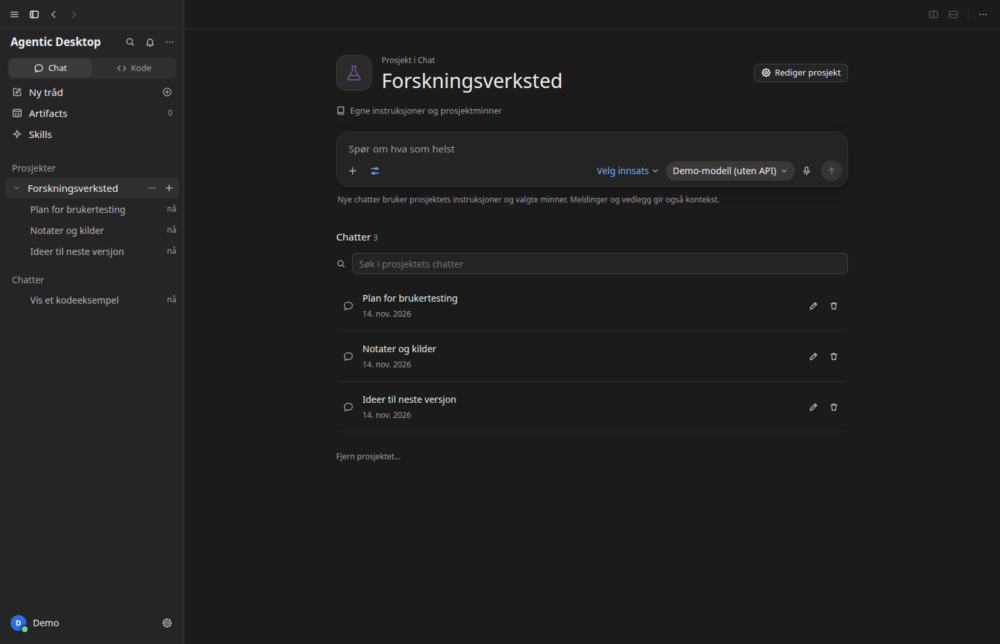
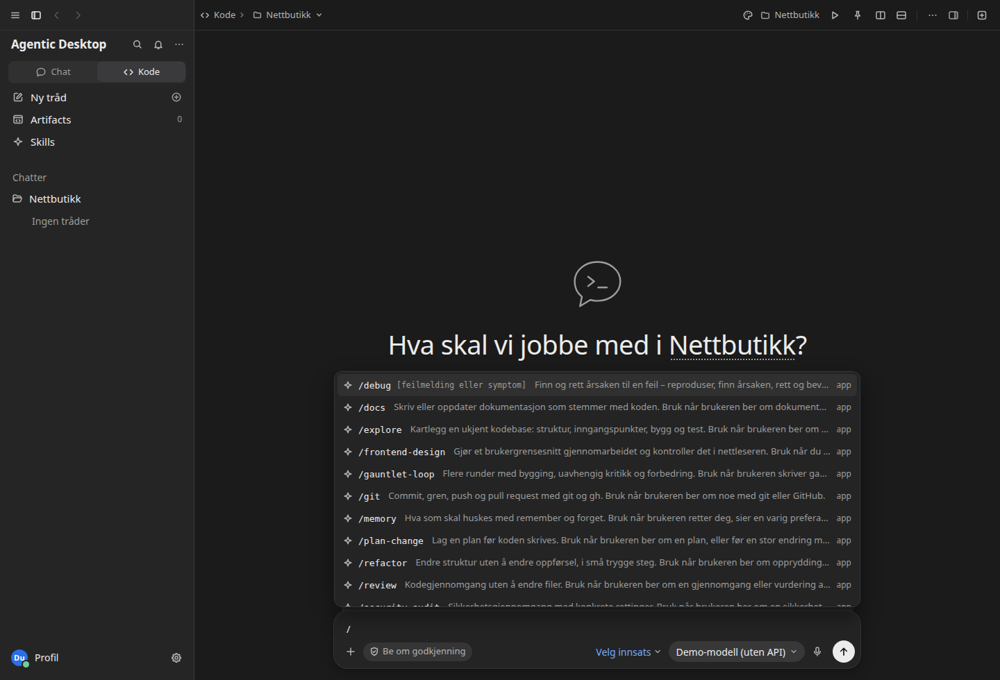
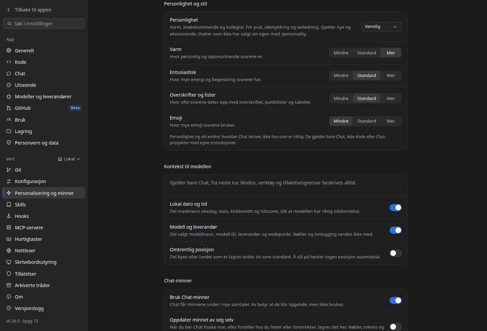
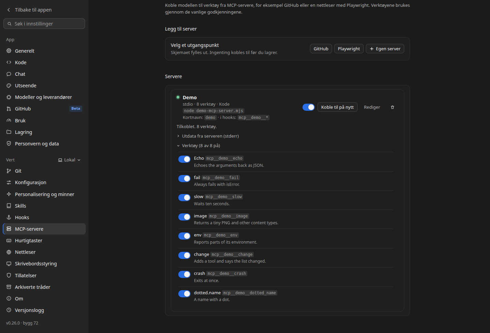
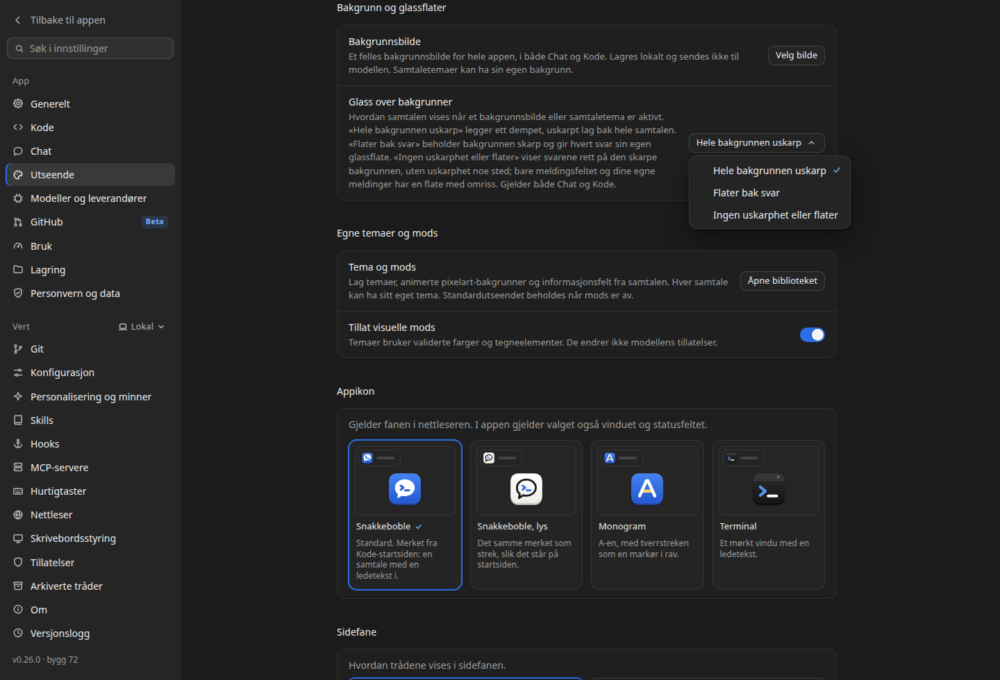
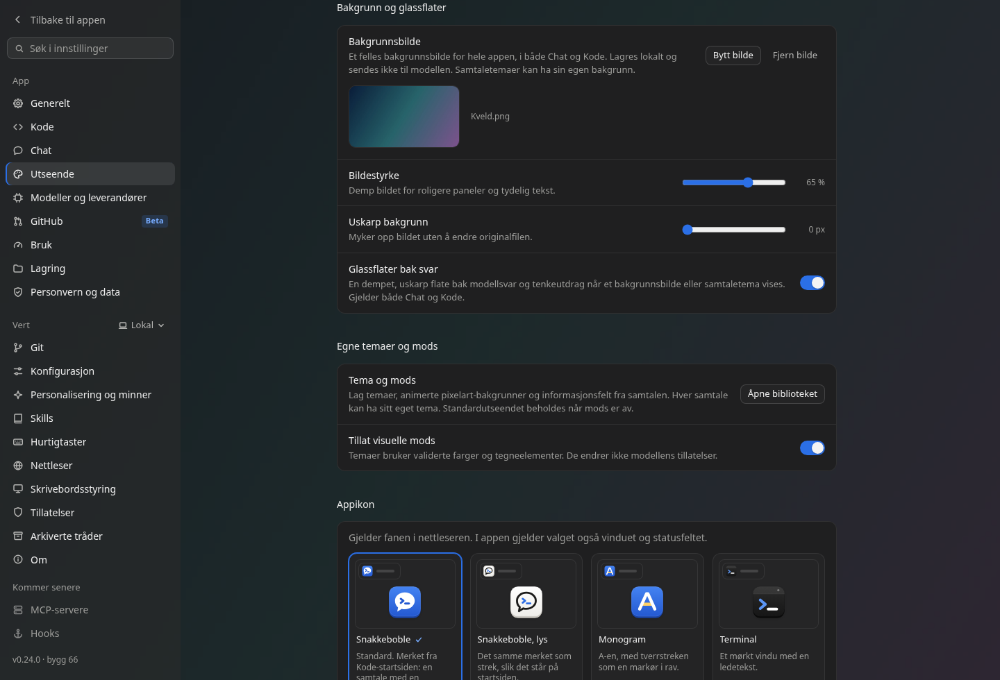
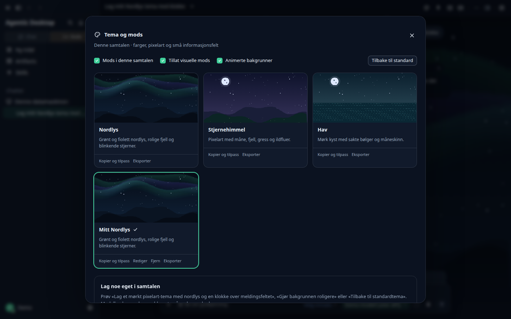
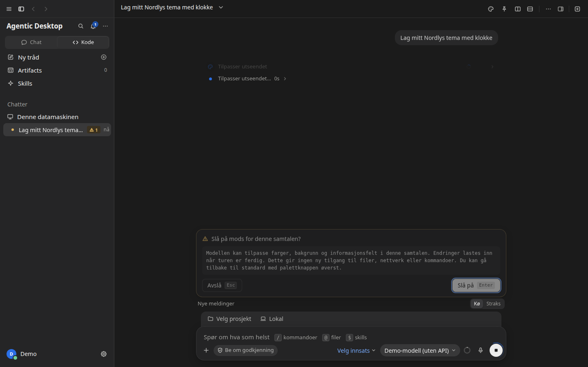
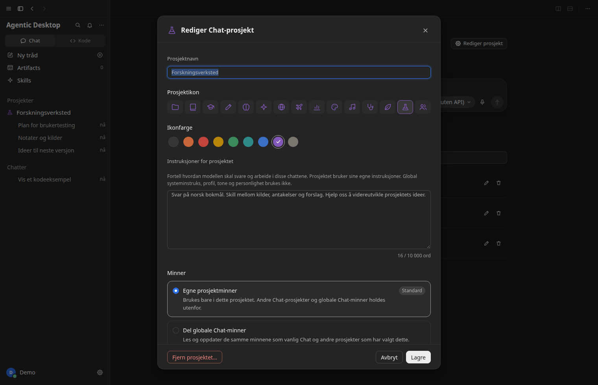
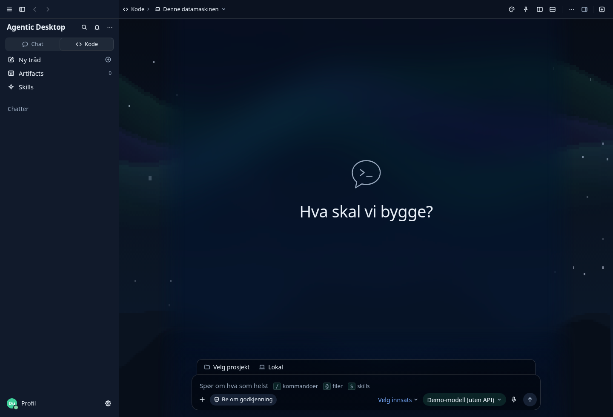

# Agentic Desktop

[Norsk versjon (README.nb.md)](README.nb.md) · [Download latest release](https://github.com/bejulian1/agentic-desktop/releases/latest) · [Changelog](CHANGELOG.md) · [Credits](CREDITS.md)

> The application UI is in Norwegian Bokmål.

Agentic Desktop is a local-first Linux desktop application (Electron + Node.js + SolidJS) for chatting and coding with large language models using **your own API keys** or local models. Talk to models in **Chat**, or hand them a folder in **Code** (`Kode`) where the agent can read and edit files, run terminal commands, and inspect what it builds in an integrated browser. Conversations, projects, and settings are stored locally in SQLite—no Agentic Desktop account, no telemetry, and a built-in demo model lets you explore the interface and tools without an API key.

| Code & changes | Chat project | React artifacts |
| --- | --- | --- |
| [](docs/bilder/kode.png) | [](docs/bilder/chat-prosjekt.png) | [](docs/bilder/artifact-react.png) |

*Click any screenshot for full size.*


*Main screenshots show v0.21.0; feature screenshots below show v0.21.1–v0.29.x. All screenshots use the demo/test models and temporary data.*

## Features

- **Model questions:** Chat and Code can ask for single or multiple selections and free-text answers using [question cards](docs/USER-QUESTIONS.md).
- **Chat:** Streaming Markdown with code blocks, tables, and math; 8 personalities and 4 style controls ([Chat personalities](docs/CHAT-PERSONALITIES.md)); Chat projects with custom instructions and isolated or shared memories ([Chat projects](docs/CHAT-PROJECTS.md)); HTML and React (JSX/TSX) artifacts rendered in an isolated local sandbox with version history; downloadable documents (`.docx`, `.xlsx`, `.pptx`, Markdown, text, CSV, JSON) and optional sandboxed Python analysis via `bubblewrap` ([Files & Python in Chat](docs/CHAT-FILES.md)); plus `/btw` side questions, `/background` parallel sessions, and `/queue` / `/steer` delivery overrides ([Side questions & background sessions](docs/SIDE-QUESTIONS.md)).
- **Code agent (`Kode`) with tools and approvals:** Works inside a project folder with tools for reading, editing, creating, and deleting files, searching (`ripgrep`), running shell commands, web search/fetch, and browser automation. Includes three permission modes (**Ask**, **Accept edits**, **Full access**), read-only **Plan mode** (`/plan`), turn-level undo, local Git branch and worktree management (`/worktree`, [Git & tools](docs/GIT-AND-TOOLS.md)), bidirectional sub-agent instances with read receipts, and shortcuts `/agents`, `/diff`, `/context`, and `/stop` ([Instances & read receipts](docs/AGENT-COLLABORATION.md)).
- **This machine (`Denne datamaskinen`):** Work in Code without selecting a project—the agent uses your home directory as its workspace with standard approvals, per-rule "Allow always", and turn undo, while sensitive paths under your home directory always prompt and are excluded from search.
- **Side panels:** A shared tab bar for **Files** (with a mini-editor in projects and read-only browsing without a project), **Changes** (line diffs with undo), **Terminal**, **Browser**, **Session**, **Team**, and **GitHub**. The Browser supports element annotations and can open the active page in the system browser ([Side panel workspace](docs/SIDEPANEL-WORKSPACE.md)).
- **MCP servers:** Built-in Model Context Protocol client supporting **stdio** and **Streamable HTTP** (`2025-11-25` and earlier), presets for GitHub and Playwright, secrets stored in the system keyring, per-tool approval, and up to 60 MCP tools per turn ([MCP servers](docs/MCP.md)).
- **Hooks:** Run your own shell commands on `PreToolUse`, `PostToolUse`, `UserPromptSubmit`, and `Stop` using a Claude Code-compatible JSON stdin/stdout contract, managed globally in Settings ([Hooks](docs/HOOKS.md)).
- **Commands and skills:** Type `/` for the active mode's commands and skills, `$` for skills only, or `/help` (alias `/commands`) for a searchable guide. Chat and Code share commands such as `/new`, `/sessions`, `/find`, and `/fork`; Code also has `/worktree` and project panel commands. There are 24 built-in skills for Code, seven of which also work in Chat: `/excel`, `/word`, `/powerpoint`, `/data-files`, `/source-brief`, `/action-items`, and `/analyze-data`. Code-only examples include `/debug`, `/benchmark`, and `/ci-triage`. Add custom skills in a Code project's `.agentic/skills/` or in `~/.config/agentic-desktop/skills/` for Code and ordinary Chat ([Command and skill guide](docs/SLASH-SKILLS.md)).
- **Inline charts:** Request a bar or line chart in Chat or Code. Charts render locally and do not require enabling Python or Artifacts ([example](docs/bilder/diagram-i-chat.png)).
- **Providers including local models:** Built-in presets for **OpenRouter**, **abliteration.ai**, **Anthropic**, **OpenAI**, and any **OpenAI-compatible** endpoint—including local models via **Ollama** and **LM Studio** without an API key—plus the built-in **Demo model** (no network or API key required).
- **Themes & visual mods:** Light and dark modes, custom global wallpaper with opacity/blur and three glass styles, and per-conversation declarative visual mods (built-in Aurora, Starry Sky, and Ocean presets, or model-authored pixel-art and color themes with per-conversation consent and WCAG contrast validation) ([Themes & visual mods](docs/UI-MODS.md)).

### Feature Previews

| Side questions (`/btw`, `/background`) | Slash-skills in Code | Chat personality & style |
| --- | --- | --- |
| [](docs/bilder/sidesporsmal.png) | [](docs/bilder/skills-meny.png) | [](docs/bilder/chat-personlighet.png) |

| MCP servers | Hooks | Glass styles over backgrounds |
| --- | --- | --- |
| [](docs/bilder/mcp-servere.png) | [](docs/bilder/hooks.png) | [](docs/bilder/glass-valg.png) |

| Global wallpaper | Appearance settings | Glass & Aurora theme |
| --- | --- | --- |
| [](docs/bilder/bakgrunn-chat.png) | [](docs/bilder/bakgrunn-innstillinger.png) | [](docs/bilder/glass-nordlys.png) |

| Aurora mod in Code | Mod library | Per-conversation consent |
| --- | --- | --- |
| [](docs/bilder/mods-nordlys.png) | [](docs/bilder/mods-bibliotek.png) | [](docs/bilder/mods-samtykke.png) |

| Chat files | Chat tools | Token calendar |
| --- | --- | --- |
| [](docs/bilder/chat-filer.png) | [](docs/bilder/chat-verktoy.png) | [](docs/bilder/tokenkalender.png) |

<details>
<summary>More screenshots: Chat, artifacts, side panel, and settings</summary>

- 
- 
- 
- 
- 
- 
- 
- 
- 

</details>

## Install

### AppImage and `.deb` (Linux x86_64)

Download prebuilt packages from [GitHub Releases](https://github.com/bejulian1/agentic-desktop/releases). The [latest release](https://github.com/bejulian1/agentic-desktop/releases/latest) includes an **AppImage**, a **`.deb`**, `SHA256SUMS`, release metadata (`RELEASEINFO.json`), and the full changelog. Builds are tested on Ubuntu 26.04. The repository is private; cloning and downloading require access on GitHub.

### Build and Install from Source

Requirements:
- Linux with GNOME (developed and tested on Ubuntu 26.04 on Wayland)
- **Node.js 26+** and npm
- Native build tools for `node-pty`: `sudo apt install build-essential python3`
- Recommended:
  - `ripgrep` (`rg`) for fast search and `@` file mentions
  - Google Chrome for web search and the browser panel when the Chromium sandbox is disabled
  - `bubblewrap` (`bwrap`) for optional isolated Python analysis in Chat

```bash
git clone https://github.com/bejulian1/agentic-desktop.git
cd agentic-desktop
./install.sh
```

`install.sh` checks prerequisites, runs `npm ci`, builds the frontend, packages the Electron app, and installs it for your user in `~/.local/opt/agentic-desktop` with a desktop entry and icon (no `sudo` required).

- **Update:** `git pull && ./install.sh` (your threads and settings in `~/.local/share/agentic-desktop` and `~/.config/agentic-desktop` are preserved).
- **Uninstall:** `./install.sh --uninstall` (user data is kept).

#### Optional: Chromium Sandbox Profile (Ubuntu 24.04+)

On Ubuntu systems that restrict unprivileged user namespaces, the launcher can fall back to starting Electron without its Chromium sandbox. In that mode the Browser panel uses separately sandboxed Google Chrome instead of an embedded Electron view. For a source install, you can load the bundled AppArmor profile to allow the Electron sandbox:

```bash
sudo install -m 644 ~/.local/opt/agentic-desktop/resources/apparmor/agentic-desktop /etc/apparmor.d/agentic-desktop
sudo apparmor_parser -r /etc/apparmor.d/agentic-desktop
```

## Quick Start

### Try Without an API Key (Demo Model)

The built-in **Demo-modell (uten API)** is selected by default. It does not call a model provider and exercises the real tools, diffs, approvals, and browser panel. Pick an empty folder in **Kode** and try prompts such as:

- `lag en side` — creates `index.html`, runs a command, opens it in the browser panel, and takes a screenshot
- `rediger` — edits `index.html` and shows a diff in Changes
- `godkjenning` — attempts to write `.env.demo` (always prompts for approval)
- `samarbeid` / `team` — demonstrates sub-agent threads and the team task list
- `/plan` then `lag en side` — runs in read-only Plan mode
- `react-artifact` / `html-spill` — creates interactive sandboxed artifacts
- `hjelp` — lists all demo prompts

### Connect a Real Provider or Local Model

1. Open **Innstillinger → Modeller og leverandører** (Settings → Models & Providers).
2. Choose **Koble til leverandør** to search the catalog or set up a custom endpoint. **Finn lokale servere** checks known local endpoints; **Anbefal modell** estimates which models fit your hardware. See the [provider guide](docs/PROVIDERS.md).
3. Enter a key if the provider needs one. The app uses the system keyring when available. Use **Test tilkobling** (Test connection), then select your model in the composer.

## Development

### Requirements

- Linux, **Node.js 26+** (`engines.node: >=26`), npm
- `build-essential` (`g++`, `make`) and `python3`
- Server and UI integration tests require `ripgrep`, working `bubblewrap` user namespaces, and Google Chrome. The Electron test runner also needs `xvfb-run` and `xauth`. See [the contributing guide](CONTRIBUTING.md#running-checks-and-tests) for build and test setup.

### Commands

| Command | Description |
| --- | --- |
| `npm ci` | Install dependencies |
| `npm start` | Build the UI if needed, then start the local server on port `4317` by default |
| `npm run typecheck` | Type-check `server/`, `web/`, and `desktop/` |
| `npm run test:server` | Run server unit and integration tests (`server/test/*.test.ts`) |
| `npm run test:ui` | Run UI end-to-end tests (`web/test/*.test.ts`) |
| `npm run test:desktop` | Run Electron desktop tests (`desktop/test/*.test.ts`) |
| `npm run build` | Build the web frontend and bump the build number in `version.json` |
| `npm run dist` | Package the Electron app to `dist-desktop/` (unpacked, `.deb`, AppImage) |
| `npm run install-local` | After `npm run dist`, install the package to `~/.local/opt/agentic-desktop` |

The server reserves its data directory until shutdown. Follow the [isolated development example](CONTRIBUTING.md#setup-and-run) to run alongside the installed app without sharing its data, configuration, keyring, or port.

### Tech Stack

- **Desktop:** Electron 45
- **Server:** Node.js 26+ running TypeScript directly (`node:sqlite`, `node-pty`, `playwright-core`, `ws`)
- **Frontend:** SolidJS + Vite, CodeMirror 6, xterm.js, React 19 (isolated artifact sandbox)

## Project Layout

```text
server/   Local Node.js server (HTTP/WebSocket API, SQLite store, agent runner, tools, providers, MCP, hooks)
web/      SolidJS + Vite frontend (Chat, Code, side panels, settings, artifact sandbox)
shared/   Shared TypeScript protocol and schema definitions (protocol, MCP, hooks, UI mods)
desktop/  Electron main/preload processes, native browser views, tray icon, AppArmor profile
skills/   Built-in slash-skills (skills/<name>/SKILL.md)
docs/     Architecture specs, feature guides, changelog (PATCHLOG.md), status notes, and screenshots
scripts/  Start, build, packaging (dist), local install, and test runner scripts
```

## Privacy and Security Model

- **Local storage, no telemetry:** Threads, projects, settings, and wallpapers stay on your machine (`~/.local/share/agentic-desktop` and `~/.config/agentic-desktop`). There is no Agentic Desktop account and no telemetry.
- **Network use:** The selected provider receives the prompt and any conversation context, attachments, and tool results needed for its response. Web tools, GitHub, and remote MCP servers make their own requests when used. Wallpapers are not sent to model providers.
- **Keys in the system keyring:** API keys, GitHub tokens, and secret MCP headers/environment variables are stored in the Linux Secret Service (GNOME Keyring via `libsecret`) when available, or in session memory only. Keys are never returned to the frontend UI, excluded from spawned shell/hook/browser environments, and redacted if echoed by an MCP server.
- **Approvals and protected paths:** Agent file modifications, commands, and MCP tool calls follow your chosen permission mode (**Ask**, **Accept edits**, or **Full access**). Protected paths—`.env*`, `.git/hooks`, `.git/config`, the app's own data/config directories, and sensitive home locations (`.ssh`, `.gnupg`, `.aws`, `.kube`, browser profiles, keyrings, shell history, etc.)—always require explicit approval and cannot be permanently auto-approved.
- **Important limitation:** Shell commands run by the coding agent execute as your Linux user. Command-line checks for protected paths are a best-effort text check, **not an OS sandbox**. Review requests carefully in untrusted repositories. Optional Chat Python uses `bubblewrap` without network or home directory access and with system libraries read-only.

See [SECURITY.md](SECURITY.md) for vulnerability reporting and full details.

## Contributing

Contributions are welcome! Please read [CONTRIBUTING.md](CONTRIBUTING.md) for setup instructions, coding conventions, how to write skills, and the pull request workflow, and follow our [Code of Conduct](CODE_OF_CONDUCT.md).

## Credits

**[bejulian1](https://github.com/bejulian1)** is the project owner and maintainer, responsible for product direction, design references, testing, and releases.

The project owner credits the following AI models for development assistance (see [CREDITS.md](CREDITS.md) for version-by-version details):

- **Anthropic Claude Opus 5.5** — used with Claude Code for the initial implementation through v0.11.0, as well as sub-agent implementation, independent code reviews, and UI test maintenance.
- **OpenAI GPT 6.1 Sol** — used with Codex and sub-agents for ongoing feature development, reviews, and fixes (including v0.11.0–v0.24.0, v0.27.0–v0.29.0, agent communication, and parent chains).
- **OpenAI GPT 6.2 Sol and GPT 6.2 Astra** — used with Codex for the command guide, skills, and conversation and project commands. Codex also implemented inline charts and reviewed and hardened the data-directory lock, reconnect behavior, and system-browser handoff.
- **Anthropic Claude Fable 5.2** — used with Claude Code from v0.24.1 onward (glass backgrounds, MCP servers, hooks, the v0.26.0 harness, built-in skills, Chat personalities, "This machine" mode without a project, and release packaging).
- **Google Gemini** — contributed the initial data-directory reservation, history-reconnect fix, and system-browser action.

GPT 6.2 Sol and GPT 6.2 Astra also contributed provider catalog entries, API compatibility, setup, and local model discovery and recommendations.

GPT 6.2 Astra implemented [dictation](docs/diktering.md) and [scheduled tasks](docs/planlagte-oppgaver.md) and removed nonfunctional controls.

Codex also contributed inline charts, [model selection for Code helpers](docs/MODELLDELEGERING.md), and [reviewable memory and skill suggestions](docs/MINNEFORSLAG.md).

Crediting AI models describes development assistance only and implies no official endorsement or affiliation with Anthropic, OpenAI, or Google.

## License

Agentic Desktop is licensed under the [MIT License](LICENSE).
