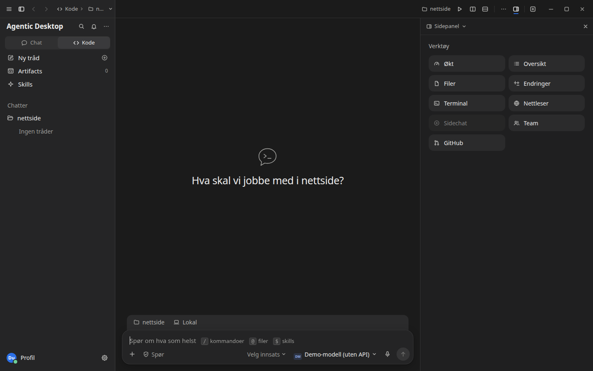
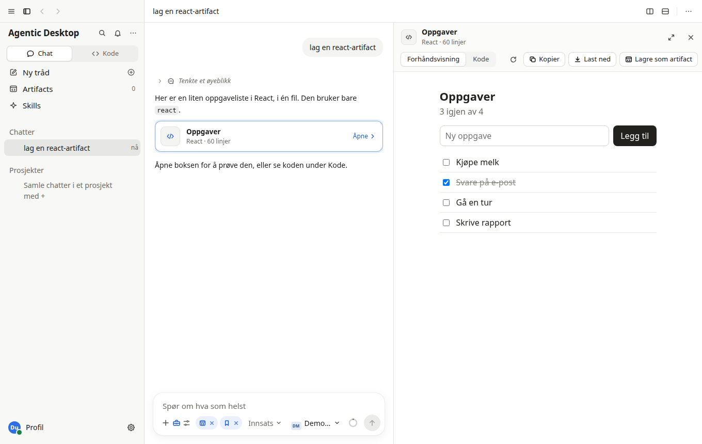

# Agentic Desktop

En agentisk kodeapp for Linux som bruker språkmodeller med **dine egne API-nøkler**. Du snakker med en modell i Chat, eller gir den et prosjekt i Kode. Der kan den lese og endre filer, kjøre kommandoer i en terminal og teste det den lager i en innebygd nettleser.

Alt ligger på maskinen din. Det er ingen konto, ingen sky og ingen telemetri. En demo-modell følger med, så du kan prøve hele appen uten nøkkel.



## Hva den kan

- **Chat og Kode.** I Chat svarer modellen med Markdown, kodeblokker, tabeller og matte. I Kode jobber den i en mappe med verktøy for filer, kommandoer, søk og nettleser.
- **Artifacts.** En hel app i én fil, i HTML eller React (JSX/TSX), blir en boks i chatten.
  - Boksen åpner et panel med **Forhåndsvisning** og **Kode**, og du kan bla mellom versjonene.
  - React kjører lokalt og uten nett, i en isolert sandkasse som ikke når appen eller filene dine.
- **Verktøy ved siden av samtalen:** terminal, filer, endringer (diff) med angre, mini-editor, økt, team og en nettleser som agenten kan styre med Playwright.
- **Tråder som samarbeider.** Hjelpetråder, team med oppgaveliste, flere ruter side om side og tråder i egne vinduer.
- **Gafler og arkiv.**
  - Du kan lage en gaffel fra hvilken som helst melding, og gaffelen viser hvor den kom fra.
  - Du kan arkivere én tråd eller et helt prosjekt, med angre.
- **Tillatelser.** Spør, Godta redigeringer eller Full tilgang. Godkjenningen kommer rett over meldingsfeltet.
- **Nøklene ligger i GNOME-nøkkelringen.** De lagres kryptert der og aldri i klartekst på disken, og grensesnittet får dem aldri tilbake.
- **Skills, AGENTS.md og minner,** både globalt og per prosjekt.
- **Lett.** Rundt 320 MB minne i hvile, med statusfelt og eget ikon. Du velger ikon i Innstillinger.



## Det du trenger

- Linux med GNOME. Laget og testet på Ubuntu 26.04.
- **Node 26** eller nyere, med npm.
- `g++`, `make` og `python3`, fordi `node-pty` bygges under installasjonen: `sudo apt install build-essential python3`
- Anbefalt:
  - `ripgrep` (`rg`), for raskt søk og `@`-menyen.
  - Google Chrome, til nettsøk og til nettleserpanelet når Chromium-sandkassen er av (se under).

## Installer

```bash
git clone https://github.com/bejulian1/agentic-desktop.git
cd agentic-desktop
./install.sh
```

Skriptet gjør dette:
1. Sjekker at verktøyene over finnes.
2. Henter avhengighetene, bygger grensesnittet og pakker Electron-appen.
3. Legger appen i `~/.local/opt/agentic-desktop`, med oppføring og ikon i appbiblioteket.

Det trenger ikke sudo. Etterpå finner du **Agentic Desktop** i «Vis apper».

- **Oppdatere:** `git pull`, og kjør `./install.sh` igjen. Trådene og innstillingene dine blir med videre.
- **Fjerne:** `./install.sh --uninstall`. Dataene i `~/.local/share/agentic-desktop` og `~/.config/agentic-desktop` blir liggende.

### Chromium-sandkassen (valgfritt)

Ubuntu 24.04 og nyere stopper apper uten egen AppArmor-profil fra å bruke Chromium-sandkassen. Appen starter likevel, uten sandkassen. Nettsider åpnes da i Chrome på maskinen, som har sin egen sandkasse.

Vil du ha sandkassen i appen også, legger du inn profilen én gang:

```bash
sudo install -m 644 ~/.local/opt/agentic-desktop/resources/apparmor/agentic-desktop /etc/apparmor.d/agentic-desktop
sudo apparmor_parser -r /etc/apparmor.d/agentic-desktop
```

Den samme kommandoen står i **Innstillinger → Om**.

## Kom i gang

### Uten nøkkel: demo-modellen

Demo-modellen er forhåndsvalgt og merket **Demo-modell (uten API)**. Den bruker ikke nettet, men går gjennom de ekte verktøyene og tillatelsene. Velg en tom mappe i **Kode**, og skriv for eksempel:

| Skriv | Hva som skjer |
|---|---|
| `lag en side` | Skriver `index.html`, kjører en kommando, åpner siden i nettleseren og tar et skjermbilde |
| `rediger` | Endrer `index.html`, så du får en diff i Endringer |
| `godkjenning` | Skriver til `.env.demo`, som alltid krever godkjenning |
| `samarbeid` / `team` | Hjelpetråder og et team med oppgaveliste |
| `/plan`, så `lag en side` | Planmodus: en plan uten å endre filer |
| `react-artifact` | En React-app i en artifact-boks. `ny versjon av react-appen` gir versjon 2. |
| `html-spill` | Et lite canvas-spill i én HTML-fil |
| `tekstblokk` | En tekstblokk med Kopier-knapp |
| `hjelp` | Hele listen |

### Med en ekte modell

**Innstillinger → Leverandører:** velg OpenRouter, OpenAI, Anthropic eller en annen, og lim inn nøkkelen.
- Feltet viser prikker. Nøkkelen lagres i GNOME-nøkkelringen.
- Lokale modeller via **Ollama** og **LM Studio** virker uten nøkkel.

Velg så modellen i meldingsfeltet.

> Leverandørene er merket **Beta** til de er prøvd med ekte nøkler. Si fra om noe ikke virker.

## Bruk

- **`/`** i meldingsfeltet gir kommandoer og skills, **`@`** legger ved filer, mapper og tråder, og **`!kommando`** kjører en kommando direkte.
- **Ruter:** dra en tråd inn i en rute, eller ut av vinduet for å få den i et eget vindu.
- **Skills** er mapper med en `SKILL.md`, i `.agentic/skills/` i prosjektet eller i `~/.config/agentic-desktop/skills/`. Hver skill blir sin egen `/kommando`.
- **Oppsett:** `~/.config/agentic-desktop/` gjelder alle prosjekter, og `.agentic/` gjelder bare prosjektet. Begge kan ha `AGENTS.md`, `settings.json` og `skills/`.
- **Snarveier** står i **Hjelp → Hurtigtaster** og kan endres. For eksempel gir Ctrl+J ny tråd, Ctrl+B skjuler sidefanen, og Alt+← og Alt+→ går tilbake og frem.
- **Lukker du vinduet**, legger appen seg i statusfeltet. Ctrl+Q avslutter.

## For utviklere

| Kommando | Hva den gjør |
|---|---|
| `npm ci` | Henter avhengighetene |
| `npm start` | Kjører appen i nettleseren på `http://127.0.0.1:4317` (localhost-versjonen) |
| `npm run build` | Bygger grensesnittet og øker byggnummeret i `version.json` |
| `npm run dist` | Pakker Electron-appen til `dist-desktop/` (mappe, .deb og AppImage) |
| `npm run install-local` | Installerer den pakkede appen i appbiblioteket |

Localhost-versjonen og appen kan ikke bruke den samme datamappen samtidig. Bruk `AD_DATA_DIR=/en/mappe npm start` hvis du vil kjøre begge.

**Teknikk:**
- Electron 45, TypeScript og Solid med Vite.
- En lokal Node-server som eneste kjøringsgrense, med `node:sqlite` for trådene.
- CodeMirror 6, xterm.js og node-pty, og playwright-core mot nettleseren.

**Dokumentasjon:**
- [`docs/SPEC.md`](docs/SPEC.md): hva appen skal være, runde for runde
- [`docs/STATUS.md`](docs/STATUS.md): hva som virker, og kjente svakheter
- [`docs/PATCHLOG.md`](docs/PATCHLOG.md): endringer per versjon
- [`docs/SERVER.md`](docs/SERVER.md): serverens API

## Status

Versjon **0.11.0**. Laget og testet på Ubuntu 26.04 med GNOME på Wayland. Det som gjenstår, står i [`docs/STATUS.md`](docs/STATUS.md).
