# Agentic Desktop

En agentisk kodeapp for Linux som bruker språkmodeller med **dine egne API-nøkler**. Du snakker med en modell i Chat, eller gir den et prosjekt i Kode. Der kan den lese og endre filer, kjøre kommandoer i en terminal og teste det den lager i en innebygd nettleser.

Samtaler, prosjekter og innstillinger lagres lokalt. Modellkall går til API-leverandøren du velger, eller til en lokal modell. Du trenger ingen Agentic Desktop-konto, og appen har ingen telemetri. En demo-modell følger med for å prøve grensesnitt og verktøy uten API-nøkkel.

Agentic Desktop er åpen kildekode under [MIT-lisensen](LICENSE). Gjeldende utgave er **v1.3.1 (bygg 85)**.

[English README](README.md) · [Last ned siste utgave](https://github.com/bejulian1/agentic-desktop/releases/latest) · [Versjonslogg](docs/PATCHLOG.md) · [Bidragsytere](CREDITS.md)

| Kode og endringer | Chat-prosjekt | React-artifacts |
|---|---|---|
| [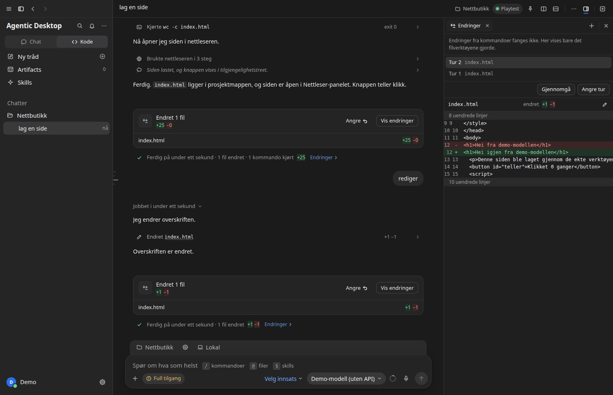](docs/bilder/kode.png) | [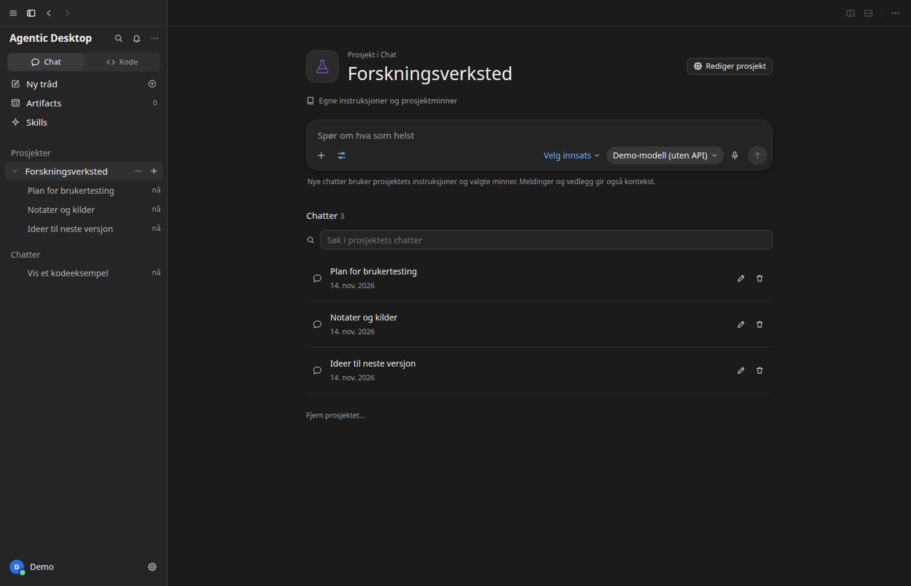](docs/bilder/chat-prosjekt.png) | [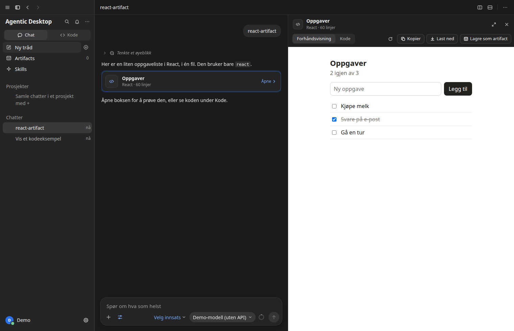](docs/bilder/artifact-react.png) |

*Klikk på et bilde for full størrelse.*

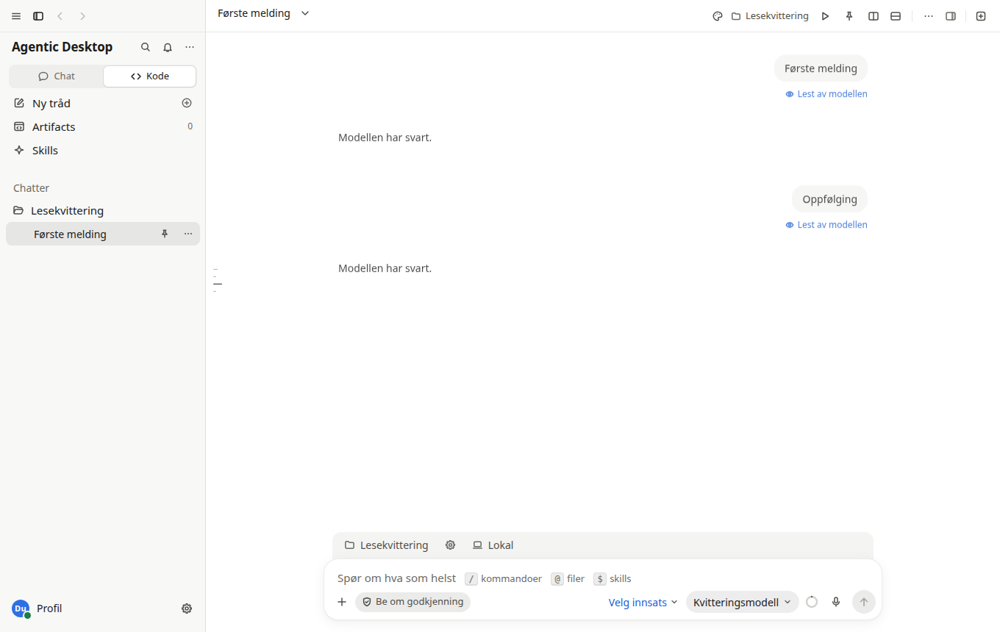

*Hovedbildene viser v0.21.0; detaljbildene viser v0.21.1/v0.22.0/v0.23.0/v0.24.0/v0.24.2/v0.26.0/v0.28.0. Alle bruker demo og midlertidige data.*

## Nytt i v1.2.0 – v1.3.1

- **Tillatelser som huskes.** «Tillat alltid» på enkle kommandoer (`git status`, `npm test`, `npx tsc` …) lagrer en prefiksregel. Kjeder, pipes, omdirigeringer og risikable programmer krever fortsatt nøyaktig treff, og beskyttede stier spør alltid. Én regel dekker alle `browser_*`-verktøy. **Innstillinger → Tillatelser** viser lagrede regler og har **Bruk på alle prosjekter** for standardmodusen.
- **Utseende og Typografi.** 11 fargetemaer med lys og mørk variant, kontrollert mot WCAG AA: Standard, Ocean, Rosa, Skog, Glød, Iris, Høy kontrast, Varm, Kald, Fjord og Solbleket. **Innstillinger → Utseende** har System/Lys/Mørk-kort, kontrastglidebryter, samtalebredde, matte-bryter og **Typografi** med skriftvalg for grensesnitt og kode og live forhåndsvisning.
- **Innstillinger → Prosjekter.** Alltid tilgjengelig, med velger for **Ingen prosjekt (Denne datamaskinen)**, Kode-prosjekter, Arkiverte og Chat-prosjekter. Kode-prosjekter har ikonmodal (Ikoner, Emoji, Monogram, 18 farger, egen fil eller prosjektets favicon), festing, arkivering/gjenoppretting, standardmodell og tenkeinnsats, arbeidsområde (gjeldende mappe eller nytt Git-arbeidstre), tillatelser og nettlesertilgang, **Handlinger** (lagrede prosjektskript med valgfri `Mod`/`Alt`-hurtigtast, som kan kjøres fra Innstillinger, Tråddetaljer eller automatisk når et nytt arbeidstre opprettes), Utsjekkinger og `.agentic/AGENTS.md`.
- **Tråddetaljer (`Ctrl+Shift+D`).** Flytende panel i Kode med prosjektmappe, **Åpne i VS Code**, prosjektets handlinger, aktiv Git-gren og arbeidstre, live endringer (`+N −M`) og underagenter.
- **Rike lenker og fargede merker.** Markdown- og backtick-fillenker (`api.ts:42`, `#L10-L20`) får fargede filtype-merker og åpnes i mini-editoren på riktig linje. `thread:<id>` blir en trådbrikke, `$skill-navn` en skill-brikke, og alle web-lenker får et farget inline-SVG-merke uten eksterne bildeforespørsler. Leverandør- og modellmerker vises i modellvelgeren, sidefanen, hover-kort, modellbytte-linjer, svarmodellkort, tenkevisning og underagentkort.
- **Leverandører og underagenter.** Skjemaet for egendefinert OpenAI-kompatibel leverandør har **API-adresse (Base URL)** og et valgfritt **Modell-ID**-felt. Underagenter kan startes på modeller fra samme API-leverandør, og modellbytte i en besvart tråd viser **Kontekstoverføring venter** med Angre.
- **Pull requests og issues på GitHub.** GitHub CLI (`gh`) oppdages automatisk. Når ingen lokale prosjekter har GitHub-remote, eller du velger det i filteret, viser **Mine på GitHub** pull requests og issues du er involvert i (`@me`) på tvers av kontoen, med GitHub-statusfarger og detaljer, diff og kommentarer i appen.

Se [versjonsloggen](docs/PATCHLOG.md) for alle endringer.

**v1.1.0:** GitHub kobles til med GitHub CLI, og knappene ved innstillingshjulet åpner pull requests og issues fra alle prosjektene, med detaljer, sjekker og diff i appen. Nye brukere får en velkomstskjerm som setter opp modeller og kan hente prosjekter og samtaler fra Claude Code, Codex CLI, Gemini CLI og Pi. Differ kan vises side om side, og nettleser, varsler og sidefanen har fått nye innstillinger. Se [versjonsloggen](docs/PATCHLOG.md).

**v1.0.0:** første offentlige utgivelse, nå åpen kildekode under MIT-lisensen. Appen finnes på tolv språk (velg under Innstillinger → Generelt → Språk), og nytt er blant annet Kode Studio, spørrekort fra modellen, diagrammer i svaret, diktering, planlagte oppgaver og én katalog for modeller og lokale modellservere. Se [versjonsloggen](docs/PATCHLOG.md).

**v0.29:** uten valgt prosjekt jobber agenten på «Denne datamaskinen», med hjemmemappen som arbeidsmappe og de vanlige godkjenningene. Kode-meldinger får lesestatus, underagenter kommuniserer bedre begge veier, foreldrekjeden beholdes i sidefanen, og `/agents`, `/diff`, `/context` og `/stop` er nye snarveier. Se [instanser og lesestatus](docs/AGENT-COLLABORATION.md).

**v0.28.0:** `/btw` gir et midlertidig sidesvar uten verktøy eller historikk; `/background` starter en egen bakgrunnsøkt mens hovedsamtalen fortsetter. `/queue` og `/steer` velger levering for én melding. Se [kommandoene](docs/SIDE-QUESTIONS.md).

**v0.27.0:** fire nye fil-skills i både Chat og Kode: `/excel`, `/word`, `/powerpoint` og `/data-files`. Modellen laster relevant SKILL.md ved behov; Chat lager nedlastbare filer med verktøyet «Lag filer». Se [Filer og Python i Chat](docs/CHAT-FILES.md) og [skill-biblioteket](https://github.com/bejulian1/agentic-skills-library).

**v0.26.0:** ny harness for Kode og Chat, 15 innebygde skills, åtte personligheter med stilvalg i Chat. Se [Slash-skills](docs/SLASH-SKILLS.md) og [Personlighet og stil](docs/CHAT-PERSONALITIES.md).

**v0.25.0:** MCP-servere (GitHub, Playwright og egne) og hooks i Innstillinger, valg mellom tre glass-stiler over bakgrunner, og versjonsloggen tilgjengelig fra Innstillinger og Om. Se [MCP-servere](docs/MCP.md) og [Hooks](docs/HOOKS.md).

**v0.24.3:** prosjektlinjen over meldingsfeltet har samme glasstone som feltet, uten den grå stripen. [Se oppdatert Kode-visning](docs/bilder/promptbar-glass.png).

**v0.24.2:** glassbakgrunnen følger samtalens og meldingsfeltets bredde med myk uttoning mot skarpe sidemarger, i både Chat og Kode.

## Nytt i v0.28

Still et sidespørsmål mens agenten jobber, eller start en parallell oppgave uten å forlate samtalen.

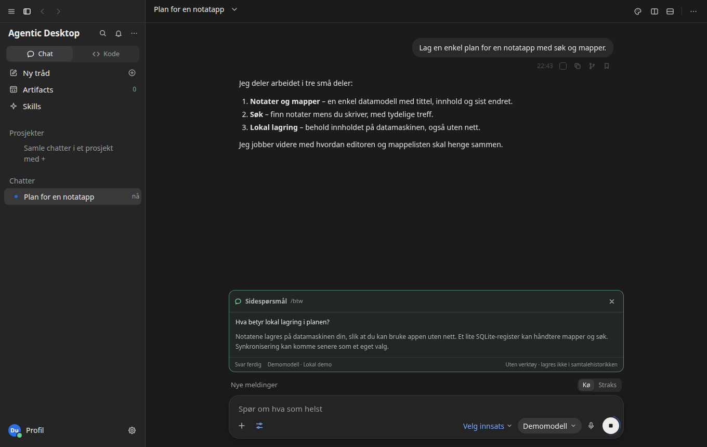

*Isolert demonstrasjon med lokale testmodeller, v0.28.0.*

## Nytt i v0.26

I v0.26 fikk Kode 15 innebygde skills, blant annet `/debug`, `/explore` og `/review`. Chat har åtte personligheter og fire stilvalg som kan skrus ned eller opp. Se [Slash-skills](docs/SLASH-SKILLS.md) og [Personlighet og stil](docs/CHAT-PERSONALITIES.md).

| Skills i Kode | Personlighet og stil |
|---|---|
| [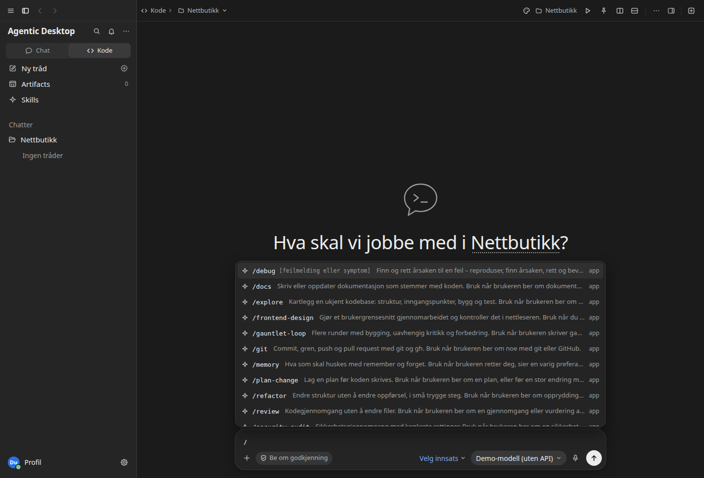](docs/bilder/skills-meny.png) | [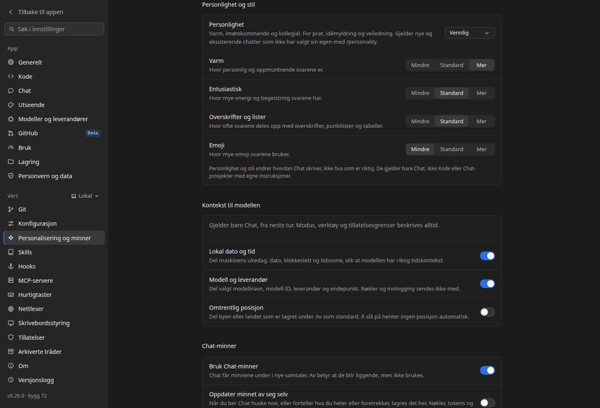](docs/bilder/chat-personlighet.png) |

## Nytt i v0.25

MCP-servere og hooks har egne sider i Innstillinger, og du velger selv hvordan glasset over bakgrunner skal se ut. Se [MCP-servere](docs/MCP.md) og [Hooks](docs/HOOKS.md).

| MCP-servere | Hooks | Glass over bakgrunner |
|---|---|---|
| [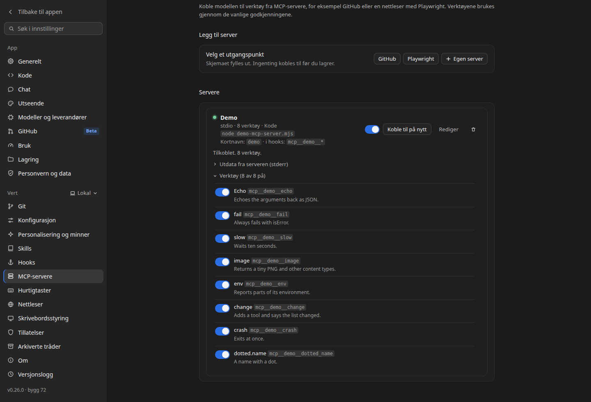](docs/bilder/mcp-servere.png) | [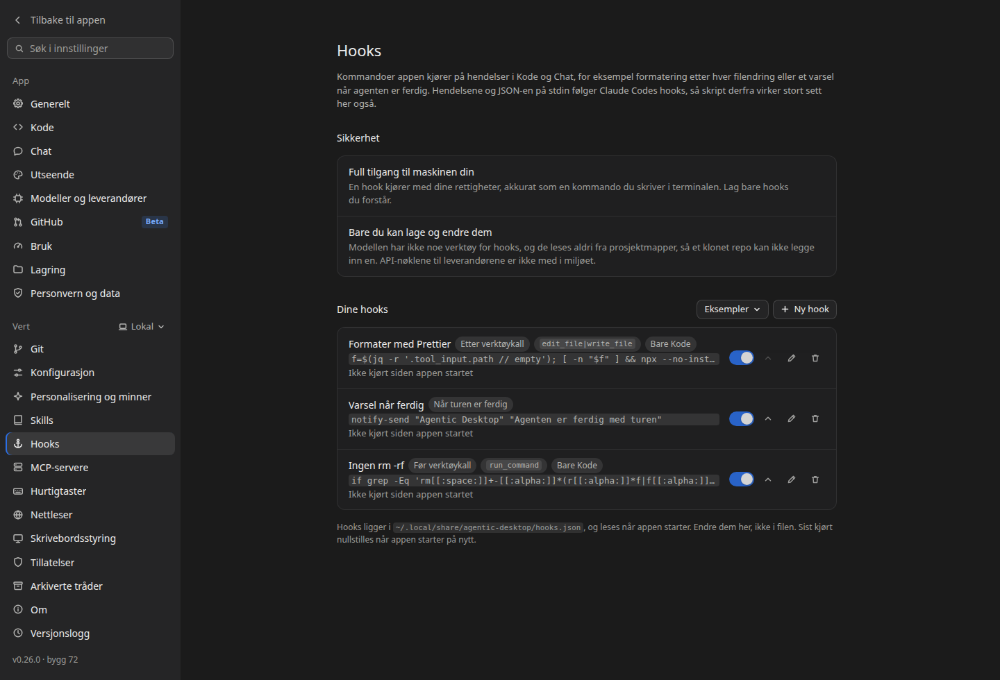](docs/bilder/hooks.png) | [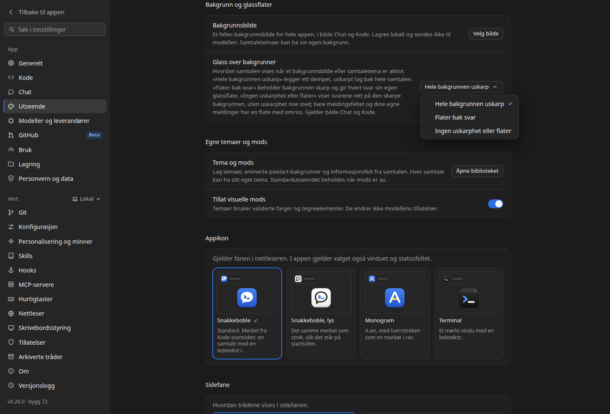](docs/bilder/glass-valg.png) |

## Nytt i v0.24

Last opp et eget bakgrunnsbilde i **Utseende**, felles for hele appen. Juster bildestyrke og uskarphet, og bruk valgfrie glassflater bak svar og tenkeutdrag. Bildet lagres lokalt og sendes ikke til modellen. Chat har egne snarveier til temaer, og samtaletemaer beholder sitt eget motiv. Se [Tema og bakgrunn](docs/UI-MODS.md).

| Global bakgrunn i Chat | Utseende | Glassflater og Nordlys |
|---|---|---|
| [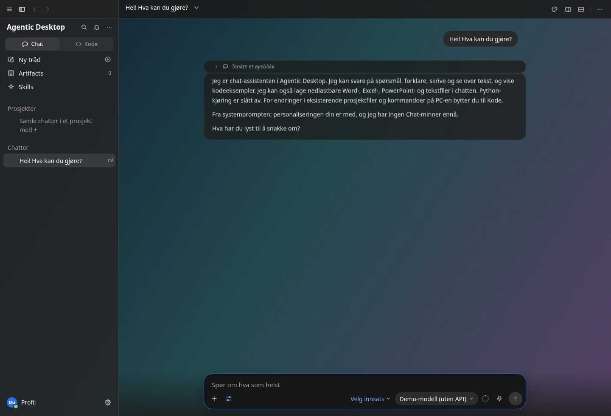](docs/bilder/bakgrunn-chat.png) | [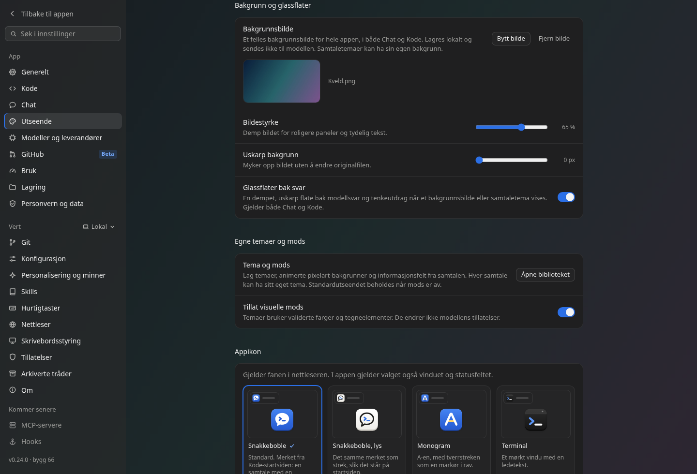](docs/bilder/bakgrunn-innstillinger.png) | [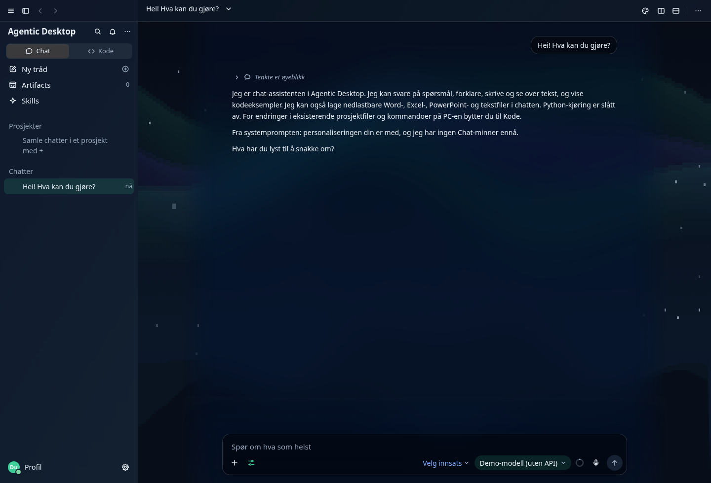](docs/bilder/glass-nordlys.png) |

*De to første bildene viser v0.27.0 med globalt bakgrunnsbilde og en tilpasset blågrønn fargepalett, også i sidepanel og innstillinger.*

## Nytt i v0.23

Tema og visuelle mods følger hver samtale. Be modellen lage en pixelart-bakgrunn, endre farger eller legge til en klokke over meldingsfeltet. Palettknappen åpner bibliotek med Nordlys, Stjernehimmel og Hav, editor og tilbakestilling. Endringer fra modellen lastes inn etter turen, med samtykke per samtale. Se [Tema og mods](docs/UI-MODS.md).

| Nordlys i Kode | Modbibliotek | Samtykke per samtale |
|---|---|---|
| [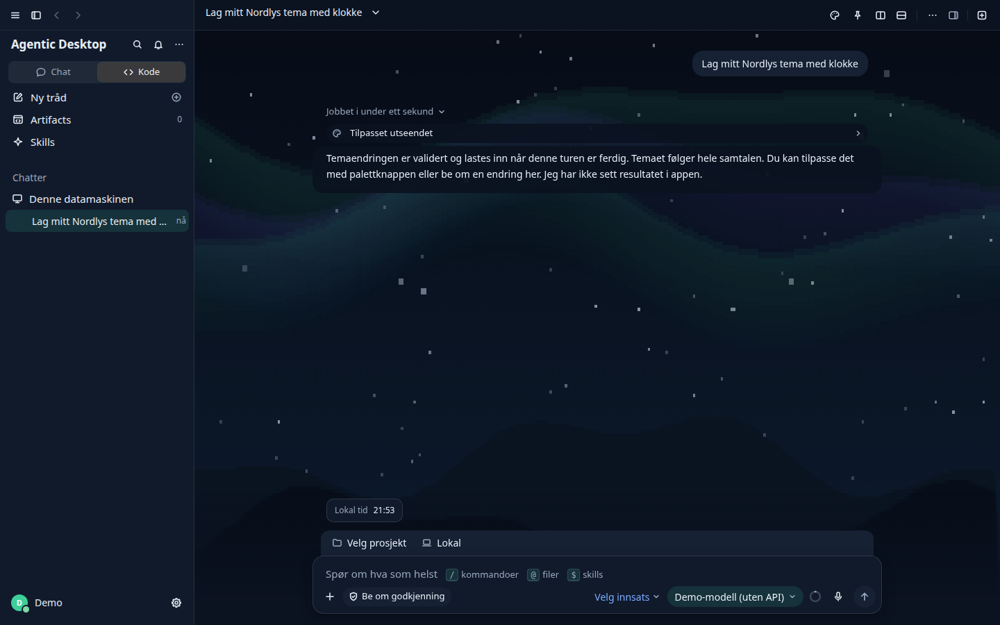](docs/bilder/mods-nordlys.png) | [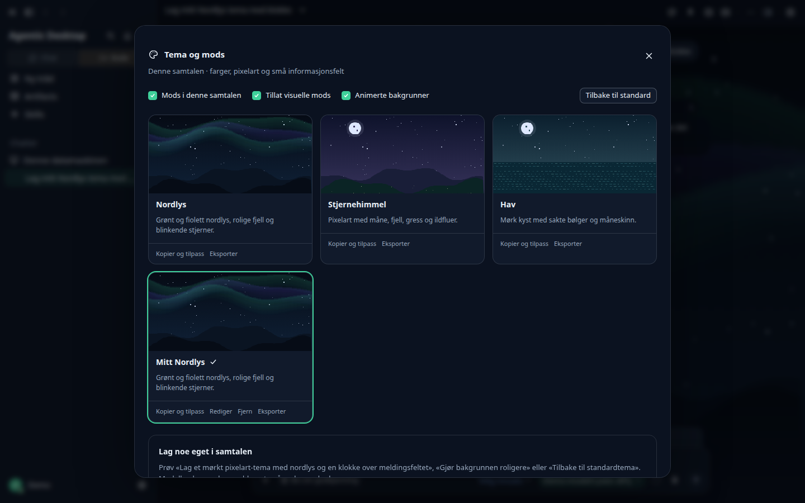](docs/bilder/mods-bibliotek.png) | [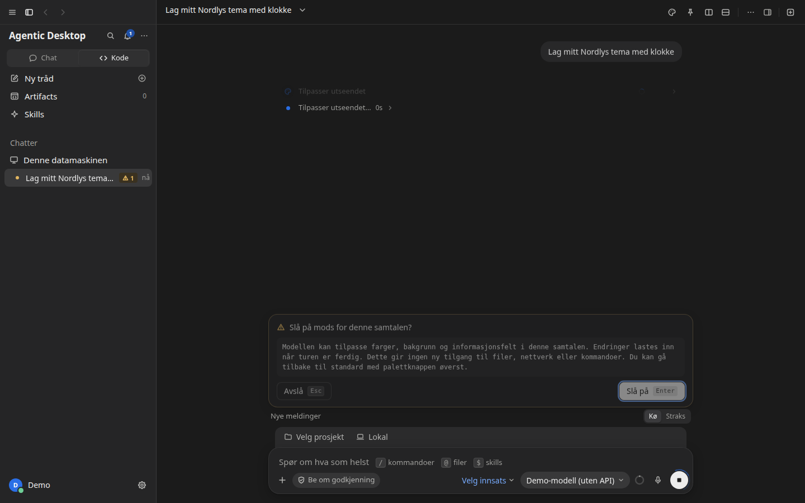](docs/bilder/mods-samtykke.png) |

## Nytt i v0.22

Chat kan lage nedlastbare Word-, Excel-, PowerPoint-, Markdown- og tekstfiler, med egne filkort. Valgfri Python-analyse bruker et isolert arbeidsområde uten nettverk eller PC-/prosjektfiler. Python har standardbiblioteket; arbeidsfiler beholdes, variabler nullstilles. Profilens tokenkalender viser dag, dato og tokens straks ved pekeren. Se [Filer og Python i Chat](docs/CHAT-FILES.md).

| Chat-filer | Chat-verktøy | Tokenkalender |
|---|---|---|
| [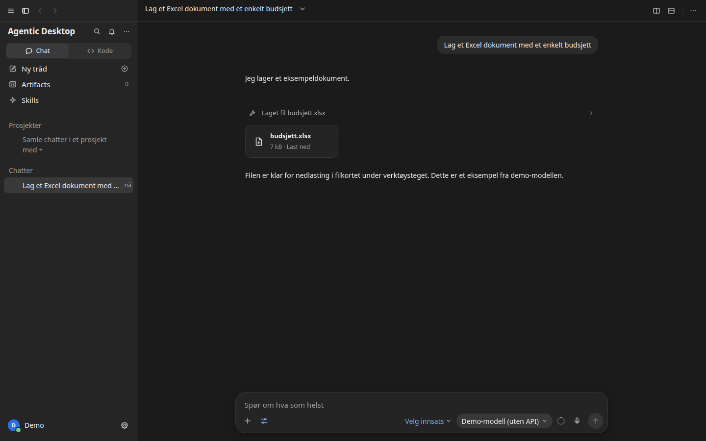](docs/bilder/chat-filer.png) | [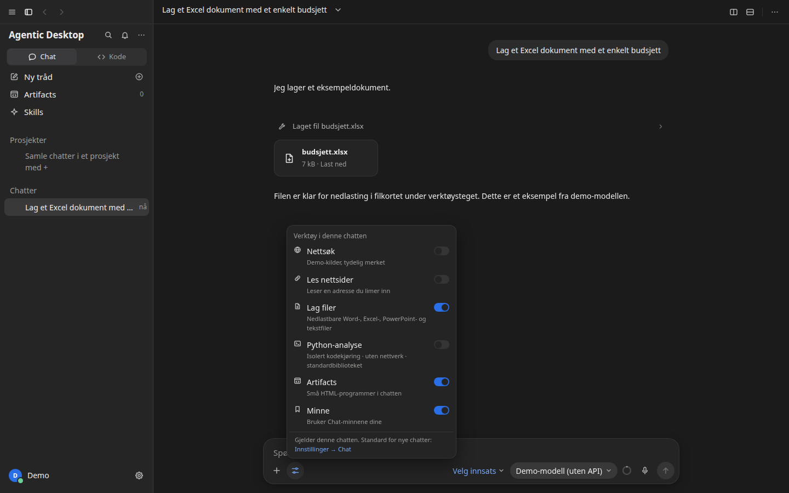](docs/bilder/chat-verktoy.png) | [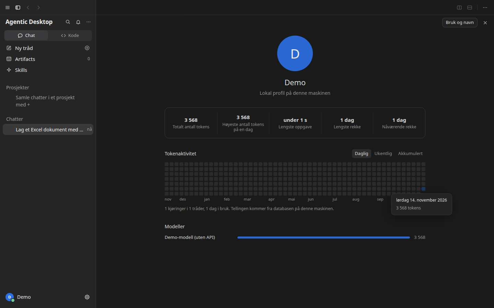](docs/bilder/tokenkalender.png) |

## Nytt i v0.21.1

Modellbytter er midtstilt i samtalen. «Fortsett der du slapp» viser riktig modusikon, og samtalenavnet kan redigeres direkte i topplinjen med en egen pil for detaljer.

## Nytt i v0.21

Chat-prosjekter har nå egen startside med meldingsfelt over chatlisten, 15 fargede ikoner, egne instruksjoner og valgbare egne eller delte Chat-minner. Global personalisering holdes utenfor prosjektet. Se [Chat-prosjekter](docs/CHAT-PROJECTS.md). Samtaletittel og navnefelt er løftet litt, og tenkesammendrag bruker en tankeboble. Et ikon under hvert svar viser faktisk modell og leverandør, og modellbytter får en diskret linje i samtalen.

## Nytt siden v0.11

- **Ryddigere Chat og Kode:** egne instrukser og minner, kontekstinnstillinger og samlet modell-/leverandørvalg.
- **Kodearbeid som er synlig:** filendringer med grønne/røde differanser, arbeidssteg, underagenter og sammendrag ved samtalen.
- **Bedre sidepanel:** felles fanerad for nettleser, terminal og verktøy, flere startfaner og manuell bruk uten prosjektmappe. Nettsider kan annoteres med elementvalg og kommentarer.
- **Grener og arbeidstrær:** opprett eller bytt lokal gren fra prosjektets tannhjul, og åpne arbeidstrær som egne prosjekter.
- **Bedre meldingsfelt:** redigerbar kø eller send straks, horisontal rulling av vedlegg og valgfri kontekstbasert TAB-fullføring med eget modellvalg.
- **Mer tilpassing:** Skills-arbeidsområde, Kode-innstillinger med egne lyse/mørke kodefarger og skrifter, og søkbar versjonslogg fra profilmenyen.

## Versjonslogg og utgivelser

- [Full versjonslogg](docs/PATCHLOG.md): alle dokumenterte versjoner og endringer, nyeste først.
- [GitHub Releases](https://github.com/bejulian1/agentic-desktop/releases): installasjonsfiler, kontrollsummer og versjonsnotater per utgivelse.
- [CHANGELOG.md](CHANGELOG.md): fast inngang til historikken fra roten av repoet.

Den samme historikken kan åpnes i appen fra **Profil → Versjonslogg**.

## Hva den kan

- **Velkomst og import.** Koble til modeller og hent lokale prosjekter og samtaler fra Claude Code, Codex CLI, Gemini CLI og Pi. [Se veiledningen.](docs/VELKOMST-OG-IMPORT.md)
- **Chat og Kode.** I Chat svarer modellen med Markdown, kodeblokker, tabeller og matte. I Kode jobber den i en mappe med verktøy for filer, kommandoer, søk og nettleser.
- **Diagrammer i svaret.** I både Chat og Kode kan du be om «Sammenlign 9,12 og 5,33 sekunder med stolper» eller «Vis temperaturene 4, 7 og 5 grader fra mandag til onsdag som en linje». Diagrammet vises mellom avsnittene. I et linjediagram åpner «Vis verdiene» hele tallrekken. Diagrammene tegnes lokalt og fungerer også med Python og Artifacts slått av. Hvis modellen sender ugyldige diagramdata, vises de som en kopierbar kodeblokk. [Se et eksempel fra chatten.](docs/bilder/diagram-i-chat.png)
- **Artifacts.** En hel app i én fil, i HTML eller React (JSX/TSX), blir en boks i chatten.
  - Boksen åpner et panel med **Forhåndsvisning** og **Kode**, og du kan bla mellom versjonene.
  - React kjører lokalt og uten nett, i en isolert sandkasse som ikke når appen eller filene dine.
- **Verktøy ved siden av samtalen:** terminal, filer, endringer (diff) med angre, mini-editor, økt, team og en nettleser som agenten kan styre med Playwright. Åpne verktøy får egne lukkbare faner; pluss lager en ny verktøystartside eller nettleserfane, etter eget valg. Nettleser, terminal og lokal fillesing fungerer også uten prosjektmappe. Se [`docs/SIDEPANEL-WORKSPACE.md`](docs/SIDEPANEL-WORKSPACE.md).
- **GitHub:** Koble til med GitHub CLI eller personlig tilgangstoken og se pull requests og issues på tvers av prosjekter, eller hele kontoen med **Mine på GitHub**, med detaljer, sjekker og diff. Appen skriver ikke til GitHub ([GitHub i Agentic Desktop](docs/GITHUB.md)).
- **Tråder som samarbeider.** Hjelpetråder, team med oppgaveliste, flere ruter side om side og tråder i egne vinduer.
- **Gafler og arkiv.**
  - Du kan lage en gaffel fra hvilken som helst melding, og gaffelen viser hvor den kom fra.
  - Du kan arkivere én tråd eller et helt prosjekt, med angre.
- **Prosjektmenyer og kø.** Høyreklikk, informasjonskort, merk som ulest og lokal eksport. Kømeldinger kan redigeres, fjernes eller flyttes til et usendt sideutkast. Se [`docs/SIDEBAR-AND-QUEUE.md`](docs/SIDEBAR-AND-QUEUE.md).
- **Tillatelser.** Velg Be om godkjenning, Godkjenn for meg eller Full tilgang direkte fra meldingsfeltet i Kode. Godkjenningskort kommer rett over meldingsfeltet, og «Tillat alltid»-regler kan ses og fjernes under **Innstillinger → Tillatelser**.
- **Nøklene ligger i GNOME-nøkkelringen.** Nye nøkler lagres der når nøkkelringen kan brukes, ellers bare i øktminnet. Grensesnittet viser lagringsstatus og eventuell eldre nøkkelfil som venter på flytting; nøklene sendes aldri tilbake til grensesnittet.
- **Skills, AGENTS.md og minner,** både globalt og per prosjekt. Skills har eget søkbart arbeidsområde med filtre, redigering, import og egne varianter av appens skills.
- **Samlede modellinnstillinger.** Modeller og leverandører på én side, prosjektvelger ved topplinjen og lokal miljømeny med faktisk gren og mappe. Se [`docs/WORKSPACE-POLISH.md`](docs/WORKSPACE-POLISH.md).
- **Tilpassing og sammendrag.** To samlede innstillingssider, egne Chat/Kode-valg, Chat-felt på 10 000 ord og Kode-sammendrag øverst til høyre. Se [`docs/SETTINGS-AND-SUMMARY.md`](docs/SETTINGS-AND-SUMMARY.md).
- **Lokale grener og arbeidstrær.** Prosjektets tannhjul og `/worktree` åpner reelle Git-handlinger. Profilmenyen har søkbar versjonslogg. Se [`docs/GIT-AND-TOOLS.md`](docs/GIT-AND-TOOLS.md).
- **Statusfelt og appikon.** Appen kan jobbe videre med vinduet lukket. Du velger ikon i Innstillinger.

<details>
<summary>Flere skjermbilder: Chat, artifacts, sidepanel og innstillinger</summary>

**Nytt i v0.21.1: navn direkte i topplinjen**

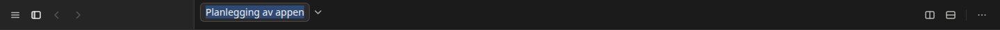

**Midtstilt modellbytte**

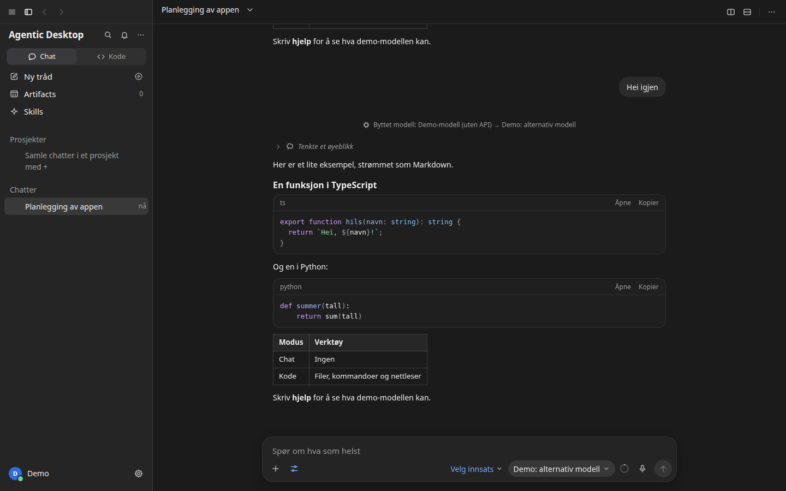

**Fortsett med riktig modusikon**

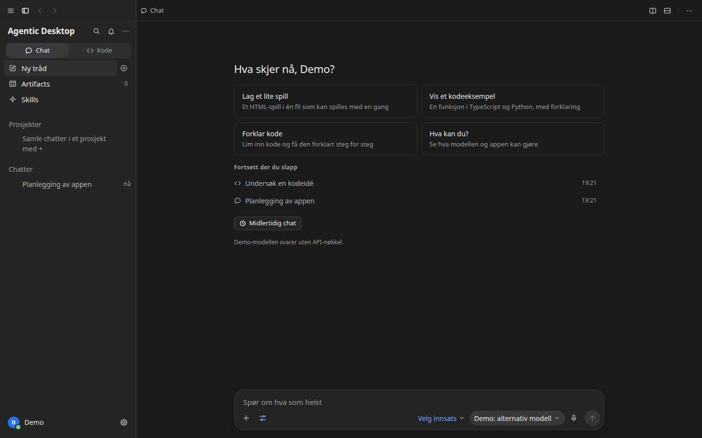

**Chat**

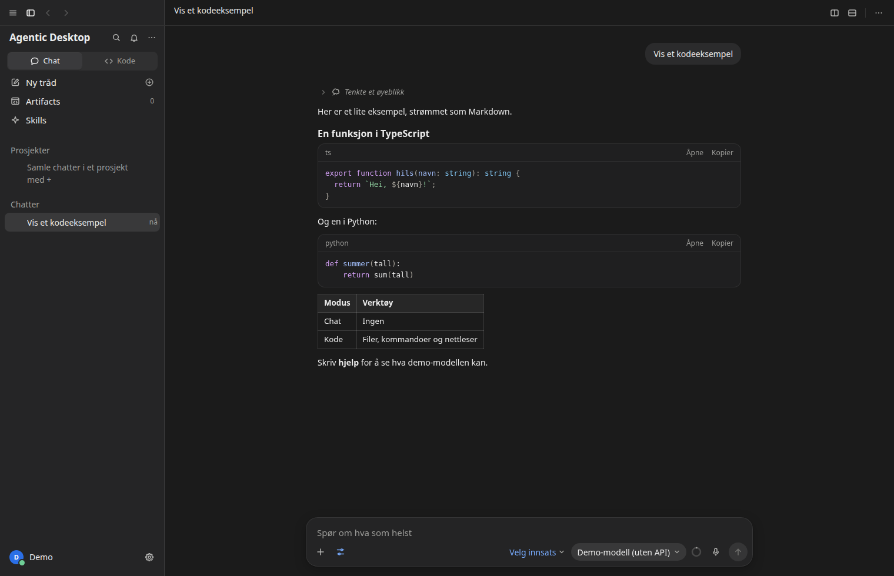

**Chat-prosjekt med egne instruksjoner og minner**


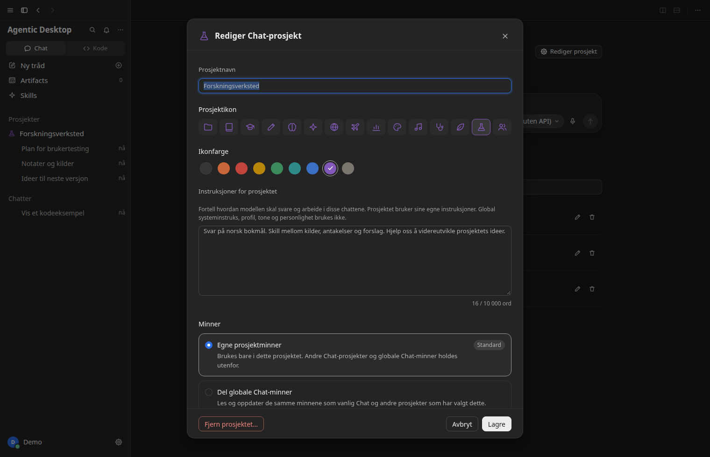

**React-artifact med forhåndsvisning**


**Koden bak artifacten**

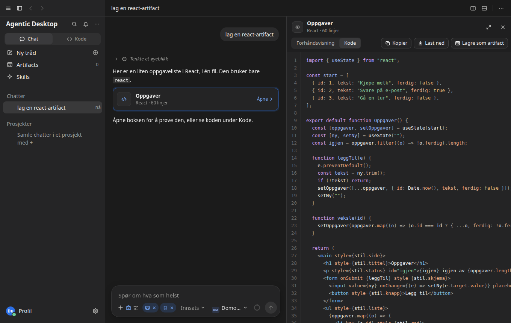

**Sidepanel med flere startfaner**

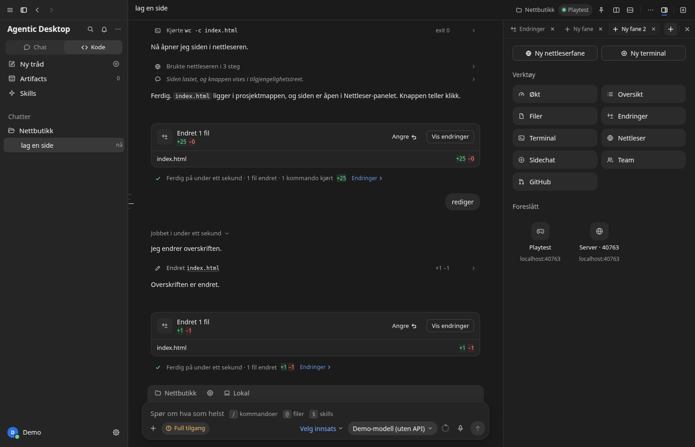

**Kodeutseende og tilpassing**

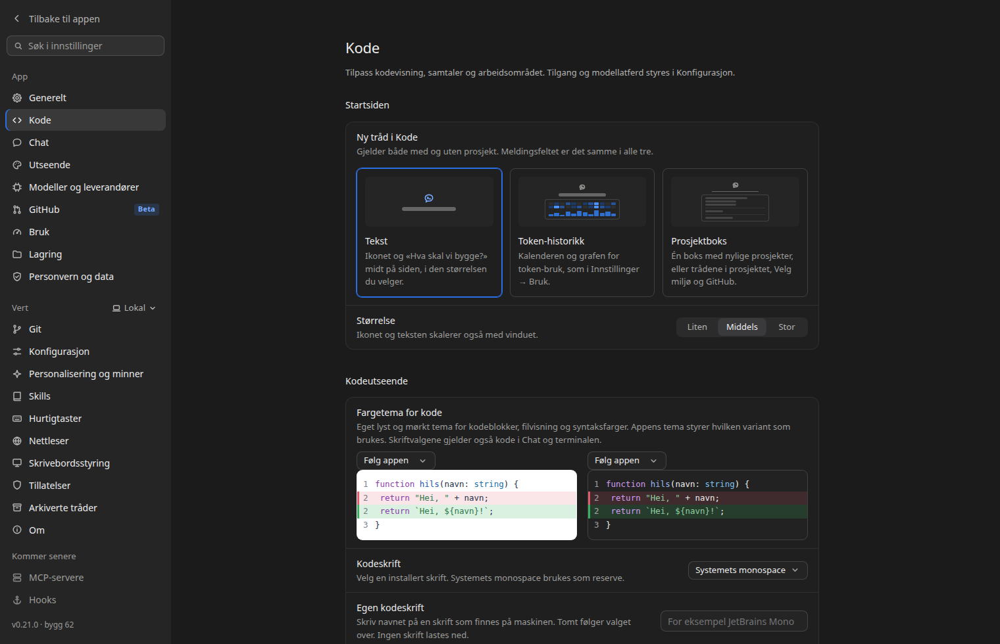

</details>

## Det du trenger

- Linux med GNOME. Laget og testet på Ubuntu 26.04.
- **Node 26** eller nyere, med npm.
- `g++`, `make` og `python3`, fordi `node-pty` bygges under installasjonen: `sudo apt install build-essential python3`
- Anbefalt:
  - `ripgrep` (`rg`), for raskt søk og `@`-menyen.
  - Google Chrome, til nettsøk og til nettleserpanelet når Chromium-sandkassen er av (se under).

## Last ned en ferdig utgave

[Releases](https://github.com/bejulian1/agentic-desktop/releases) er åpne for alle, uten GitHub-konto. Hver utgave har AppImage og `.deb` for Linux x86_64, `SHA256SUMS`, full versjonslogg (`VERSJONSLOGG.md`) og `RELEASEINFO.json` med versjon, bygg, plattform og kildecommit. Utgavene er bygget og testet på Ubuntu 26.04.

```bash
sha256sum -c SHA256SUMS --ignore-missing   # kontroller filene du lastet ned
chmod +x Agentic-Desktop-*-x86_64.AppImage && ./Agentic-Desktop-*-x86_64.AppImage
# eller: sudo apt install ./agentic-desktop_*_amd64.deb
```

## Bygg og installer fra kildekode

```bash
git clone https://github.com/bejulian1/agentic-desktop.git
cd agentic-desktop
./install.sh
```

Skriptet gjør dette:
1. Sjekker at verktøyene over finnes.
2. Henter avhengighetene, bygger grensesnittet og pakker Electron-appen.
3. Legger appen i `~/.local/opt/agentic-desktop`, med oppføring og ikon i appbiblioteket.

Det trenger ikke sudo. Etterpå finner du **Agentic Desktop** i «Vis apper».

- **Oppdatere:** `git pull`, og kjør `./install.sh` igjen. Trådene og innstillingene dine blir med videre.
- **Fjerne:** `./install.sh --uninstall`. Dataene i `~/.local/share/agentic-desktop` og `~/.config/agentic-desktop` blir liggende.

### Chromium-sandkassen (valgfritt)

På Ubuntu-maskiner som begrenser brukernavnerom, kan appen starte Electron uten Chromium-sandkassen. Da bruker nettleserpanelet Google Chrome med sin egen sandkasse i stedet for en innebygd Electron-visning.

Vil du ha sandkassen i appen også, legger du inn profilen én gang:

```bash
sudo install -m 644 ~/.local/opt/agentic-desktop/resources/apparmor/agentic-desktop /etc/apparmor.d/agentic-desktop
sudo apparmor_parser -r /etc/apparmor.d/agentic-desktop
```

Den samme kommandoen står i **Innstillinger → Om**.

## Kom i gang

### Uten nøkkel: demo-modellen

Demo-modellen er forhåndsvalgt og merket **Demo-modell (uten API)**. Den bruker ikke nettet, men går gjennom de ekte verktøyene og tillatelsene. Velg en tom mappe i **Kode**, og skriv for eksempel:

| Skriv | Hva som skjer |
|---|---|
| `lag en side` | Skriver `index.html`, kjører en kommando, åpner siden i nettleseren og tar et skjermbilde |
| `rediger` | Endrer `index.html`, så du får en diff i Endringer |
| `godkjenning` | Skriver til `.env.demo`, som alltid krever godkjenning |
| `samarbeid` / `team` | Hjelpetråder og et team med oppgaveliste |
| `/plan`, så `lag en side` | Planmodus: en plan uten å endre filer |
| `react-artifact` | En React-app i en artifact-boks. `ny versjon av react-appen` gir versjon 2. |
| `html-spill` | Et lite canvas-spill i én HTML-fil |
| `tekstblokk` | En tekstblokk med Kopier-knapp |
| `hjelp` | Hele listen |

### Med en ekte modell

Åpne **Innstillinger → Modeller og leverandører → Koble til leverandør**. Søk i katalogen eller filtrer på **Sky**, **Gatewayer** eller **Lokal drift**. **Finn lokale servere** sjekker standardadressene på maskinen. **Anbefal modell** gir et minneanslag før du eventuelt laster ned modellen selv. [Se oppsett og skjermbilde.](docs/PROVIDERS.md)
- Feltet viser prikker. Nøkkelen lagres i GNOME-nøkkelringen.
- Lokale modeller via **Ollama** og **LM Studio** virker uten nøkkel.

Velg så modellen i meldingsfeltet.

> OpenRouter og abliteration.ai er bekreftet av brukeren med ekte tilkobling. Leverandørene har ingen Beta-merker. OpenAI og Anthropic er kontrollert mot lokale prøveservere; test din egen konto med **Test tilkobling** under leverandøren.

## Bruk

- **`/`** i meldingsfeltet gir kommandoer og skills, **`@`** legger ved filer, mapper og tråder, og **`!kommando`** kjører en kommando direkte i Kode.
- **TAB-forslag:** slå på **Generelt → Samtale → Autofullfør meldinger med TAB**, og velg eventuelt en egen modell. Fra tredje brukermelding vises grå forslag etter to tidligere besvarte turer. TAB godtar uten å sende; Escape avviser. Se [`docs/PROMPT-COMPLETION.md`](docs/PROMPT-COMPLETION.md).
- **Nytt prosjekt i Kode:** velg **Nytt prosjekt**, gi prosjektet et navn og legg til en mappe med Ubuntus mappevelger. Bekreft at du stoler på mappen før prosjektet opprettes. I localhost-versjonen brukes `zenity`; hvis den ikke er tilgjengelig, får du appens mappevelger.
- **Chat:** Prosjekter står over Chatter i sidefanen. Knappen med innstillingsikon ved plussknappen samler Chat-funksjonene, og personlighet velges under **Innstillinger → Chat** for den aktive chatten eller utkastet.
- **Standardinstrukser:** Chat-personalisering kommer med en redigerbar systeminstruks og egen **Gjenopprett standard**. Kode-standarden kan gjenopprettes under Konfigurasjon med diff og sikkerhetskopi. Kildene ligger i [`docs/system-instructions/`](docs/system-instructions/README.md).
- **Agentvalg:** Under **Innstillinger → Modeller og leverandører** kan du slå automatisk komprimering av eller på og velge 1–1000 steg per tur. Standard er på og 50 steg. `/compact` komprimerer manuelt også når automatikk er av.
- **Ruter:** dra en tråd inn i en rute, eller ut av vinduet for å få den i et eget vindu.
- **Kommandoer og skills:** Skriv `/` for kommandoer og skills i modusen du bruker, `$` for bare skills, eller `/help` (`/commands`) for en søkbar guide. Kode har 29 innebygde skills, inkludert `/benchmark` og `/ci-triage`. Sju er også tilgjengelige i Chat, blant annet `/source-brief`, `/action-items` og `/analyze-data`. En egen skill er en `SKILL.md` i `.agentic/skills/` i Kode-prosjektet eller i `~/.config/agentic-desktop/skills/`. [Se hele katalogen.](docs/SLASH-SKILLS.md#innebygde-skills)
- **Nettleser:** Fra menyen ved adressefeltet kan du åpne den aktive siden i standardnettleseren uten å lukke fanen i panelet.
- **Grener og arbeidstrær:** velg et Kode-prosjekt og åpne tannhjulet ved meldingsfeltet. `/worktree` åpner samme dialog. Repoet må ha en første commit. Appen gjør ingen automatisk stash, commit eller push.
- **Oppstart og historikk:** appen starter med en tom samtale i valgt/sist brukte modus. Velg gjenopptaking under Generelt om du vil fortsette der du slapp. Profilmenyen har **Versjonslogg** med hele historikken.
- **Oppsett:** `~/.config/agentic-desktop/` gjelder alle prosjekter, og `.agentic/` gjelder bare prosjektet. Begge kan ha `AGENTS.md`, `settings.json` og `skills/`.
- **Snarveier** står i **Hjelp → Hurtigtaster** og kan endres. For eksempel gir Ctrl+J ny tråd, Ctrl+B skjuler sidefanen, og Alt+← og Alt+→ går tilbake og frem.
- **Lukker du vinduet**, legger appen seg i statusfeltet. Ctrl+Q avslutter.

## Versjoner og publisering

Nye ferdigtestede appversjoner får oppdatert versjons- og byggnummer, commit på GitHub og en tilhørende [Release](https://github.com/bejulian1/agentic-desktop/releases) med versjonslogg, installasjonsfiler og kontrollsummer. Publiseringsrutinen står i [AGENTS.md](AGENTS.md).

## For utviklere

GitHub-repoet inneholder appkode, byggeskript, dokumentasjon og automatiserte tester, men ikke brukerdata eller ferdigbygde installasjonspakker. Se [bidragsveiledningen](CONTRIBUTING.md) for isolert oppsett og testkrav.

| Kommando | Hva den gjør |
|---|---|
| `npm ci` | Henter avhengighetene |
| `npm start` | Kjører appen i nettleseren på `http://127.0.0.1:4317` (localhost-versjonen) |
| `npm test` | Kjører typekontroll og servertester |
| `npm run build` | Bygger grensesnittet og øker byggnummeret i `version.json` |
| `npm run dist` | Pakker Electron-appen til `dist-desktop/` (mappe, .deb og AppImage) |
| `npm run install-local` | Installerer den pakkede appen i appbiblioteket |

Localhost-versjonen og appen kan ikke bruke samme datamappe samtidig. Bruk [det isolerte utviklingsoppsettet](CONTRIBUTING.md#setup-and-run) hvis du vil kjøre begge.

**Teknikk:**
- Electron 45, TypeScript og Solid med Vite.
- En lokal Node-server som eneste kjøringsgrense, med `node:sqlite` for trådene.
- CodeMirror 6, xterm.js og node-pty, og playwright-core mot nettleseren.

**Dokumentasjon:**
- [`docs/SPEC.md`](docs/SPEC.md): hva appen skal være, runde for runde
- [`docs/STATUS.md`](docs/STATUS.md): hva som virker, og kjente svakheter
- [`docs/PATCHLOG.md`](docs/PATCHLOG.md): endringer per versjon
- [`docs/SERVER.md`](docs/SERVER.md): serverens API

## Status

Laget og testet på Ubuntu 26.04 med GNOME på Wayland. Se [utgivelsene](https://github.com/bejulian1/agentic-desktop/releases) og [statusnotatene](docs/STATUS.md).

Slash-skills er beskrevet i [brukerveiledningen](docs/SLASH-SKILLS.md).

Valgfri modellkontekst er beskrevet i [kontekstveiledningen](docs/MODEL-CONTEXT.md).

## Bidragsytere

**[bejulian1](https://github.com/bejulian1)** er prosjekteier og står for produktvalg, referanser og testing.

Prosjekteieren krediterer følgende modeller for AI-assistanse:

- **Anthropic Claude Opus 5.5**, brukt med Claude Code til den opprinnelige implementeringen. Koordinerte 1.0.0 og 1.1.0, bygde PR #4 i v1.2.0 (prefiksregler, underagenter på samme API-leverandør, Base URL og Modell-ID, kontekstoverføring, innlimte bilder og automatisk `gh`), PR #7 og #8 i v1.3.0 (komplett Prosjekter-side, Handlinger, Typografi, fargede modellmerker og Mine på GitHub) og PR #9 i v1.3.1 (klikkbare fil- og trådlenker, merker på web-lenker og `$skill`-brikker), og en egen skrivebeskyttet `$review`- og `$frontend-design`-gjennomgang av v1.3.0 som ga rettelsene i v1.3.1. Oppdaterte også README-ene og CREDITS.md for v1.3.1.
- **OpenAI GPT 6.1 Sol**, brukt med Codex og underagenter til videreutvikling, gjennomgang og feilretting, blant annet agentkommunikasjon og foreldrekjeder i v0.29.0.
- **OpenAI GPT 6.2 Sol og GPT 6.2 Astra**, brukt med Codex til kommandoveiledningen, skills og kommandoer for samtaler og prosjektpaneler. Codex har også bidratt med diagrammer og gjennomgang av datamappelåsen, gjenkobling etter omskriving og åpning i standardnettleseren.
- **Anthropic Claude Fable 5.2**, brukt med Claude Code fra v0.24.1: glassbakgrunnen og valget mellom glass-stiler, MCP-servere og hooks (v0.25.0), ny harness, innebygde skills og Chat-personligheter (v0.26.0), bygget og kontrollert sammen med Claude Opus 5.5-underagenter, samt bygg og publisering.
- **Anthropic Claude Sonnet 5.5** bygde PR #6 i v1.2.0: temaene Ocean, Rosa, Skog, Glød og Iris, kontrast-/breddeinnstillinger, egen Prosjekter-side i Innstillinger, monogram- og bildeikoner, utvidet favicon-søk, smarte lenke-/filbrikker, innebygd GitHub-detaljvisning i sidepanelet og flytende Tråddetaljer-meny.
- **Google Gemini** bidro med første versjon av datamappelåsen, gjenkoblingsrettelsen og menyvalget for standardnettleseren; **Gemini 4 Neon** fullførte Kode Studio, bygde innstillingene for differ, nettleser, varsler og sidefane i v1.1.0, gjorde Ocean-temaet lysere og la inn fargede favicons i v1.2.1, og koordinerte v1.2.0–v1.3.1 i Google Antigravity med fletting av PR-ene, oversettelse til alle elleve språk, rettelser og designpolering etter gjennomgangen av v1.3.1, kontroll, bygg og utgivelse.

GPT 6.2 Sol og GPT 6.2 Astra bidro også med leverandørkatalogen, API-kompatibilitet, oppsett og anbefalinger for lokale modellservere.

GPT 6.2 Astra implementerte [diktering](docs/diktering.md) og [planlagte oppgaver](docs/planlagte-oppgaver.md) og fjernet uvirksomme betjeningselementer.

Se [CREDITS.md](CREDITS.md) for bakgrunn. Krediteringen beskriver AI-assistanse; den innebærer ingen offisiell tilknytning til Anthropic, OpenAI eller Google.

Agentic Desktop er lisensiert under [MIT-lisensen](LICENSE).
