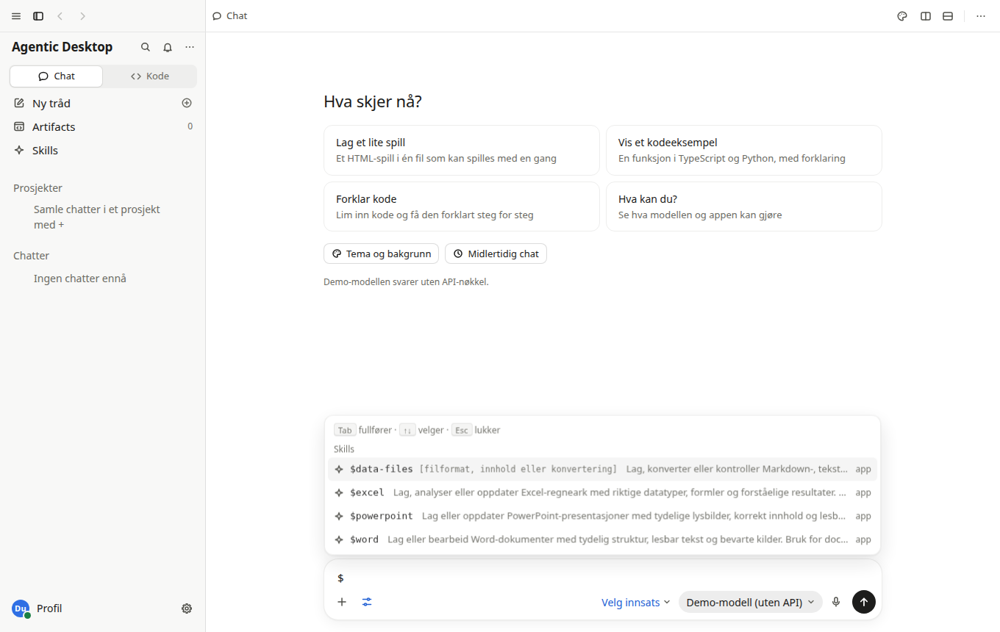

# Filer og Python i Chat

Chat har egne verktøy for nedlastbare filer. De endrer ikke filer i Kode-prosjektene dine.

- **Lag filer** lager ekte `.docx`, `.xlsx` og `.pptx`, samt Markdown, tekst, CSV og JSON. Modellen gir innhold og struktur til appens dokumentgenerator. Excel kan ha enkle eksplisitte formler; aktive/eksterne koblinger og makroer støttes ikke. Filkort med nedlasting vises når verktøyet er ferdig.
- **Python-analyse** er valgfritt og av som standard. Slå det på under Verktøy ved meldingsfeltet, eller velg standard for nye chatter under Innstillinger → Chat. Krever Linux med Python 3 og bubblewrap; utilgjengelig isolering gir ingen usikret reservekjøring.
- Python bruker standardbiblioteket, blant annet CSV, JSON, statistikk, matematikk og SQLite. NumPy, pandas og matplotlib er ikke inkludert. Hver kjøring starter en ny prosess: variabler nullstilles, men støttede arbeidsfiler beholdes innenfor chat-konteksten. Bare tekstfiler som faktisk er vedlagt samtalen og tidligere resultatfiler går inn i arbeidsområdet. Opplasting/tolkning av eksisterende Word-/Excel-/PowerPoint-filer er ikke innført.
- Modellen får verktøynavn og faktiske begrensninger i systemkonteksten. Dokumenteksport krever et vellykket verktøyresultat; en kodeblokk betyr ikke at koden er kjørt eller en fil er lagret.

## Skills for filarbeid

Fire innebygde fil-skills støtter både Chat og Kode: `/excel`, `/word`, `/powerpoint` og `/data-files` (Markdown, tekst, CSV og JSON). Du kan velge dem med `/` eller `$`, eller be om en fil på vanlig språk. Modellen får navn og beskrivelse og bes om å laste relevant `SKILL.md` med `use_skill` før den lager filen. Bare den relevante instruksjonen lastes, ikke alle fire.

Skillene veileder om struktur, datatyper, formler og kontroll. De følger de faktiske verktøyene: Chat bruker dokumentgeneratoren, mens Kode kan bruke tilgjengelige biblioteker i det valgte prosjektet. Chat-prosjekter kan bruke de innebygde skillene uten å få globale bruker-skills eller Kode-instruksjoner. «Lag filer» og «Python-analyse» må fortsatt være aktivert for å bruke de respektive verktøyene.

Chat-generatoren har faste maler. Excel-formler kan ha en oppgitt resultatverdi, men beregnes ikke av en regnearkmotor i appen. Word har enkel formatering, og PowerPoint har en tekstbasert bredformatmal med notater. Eksisterende Office-filer, avanserte maler, bilder/diagrammer og visuell forhåndskontroll krever passende verktøy i Kode. En skill installerer ingen nye biblioteker eller gir nye tillatelser.

## Isolering og grenser

Python kjører uten nettverk, hjemmemappe, API-nøkler eller Kode-prosjektfiler. Kjøretidsbibliotekene er skrivebeskyttet. Arbeidsfiler overføres som begrensede bytepakker til et midlertidig filsystem; ingen skrivbar vertsmappe monteres i Python. Kjøringen stoppes ved avbrytelse, tidsavbrudd eller for store utdata. Grensene er 30 sekunder, 512 MB prosessminne, 10 MB per fil og 20 MB resultatfiler per kjøring. Arbeidsområdet har 64 MB midlertidig plass. Bare vanlige filer på øverste nivå eksporteres; mapper og symlenker utelates.

Serveren lagrer resultatene med egne tilfeldige ID-er, validerte filnavn og autentiserte nedlastingslenker. Maks 200 lagrede filversjoner/50 MB per chat. Ny versjon av en fil overskriver ikke en eldre nedlasting. Filene slettes med chatten. Midlertidige Chat-filer slettes også ved avslutning. Flytting mellom Chat-prosjekter eller endring av prosjektets kontekst gir et nytt arbeidsområde; historiske nedlastingskort beholdes for manuell bruk.

Python kan også be dokumentgeneratoren om Office-filer via `from agentic_files import create_document` når **Lag filer** er på. Filformatene lages av appens generator, uten å kjøre modellgenerert JavaScript på verten.
