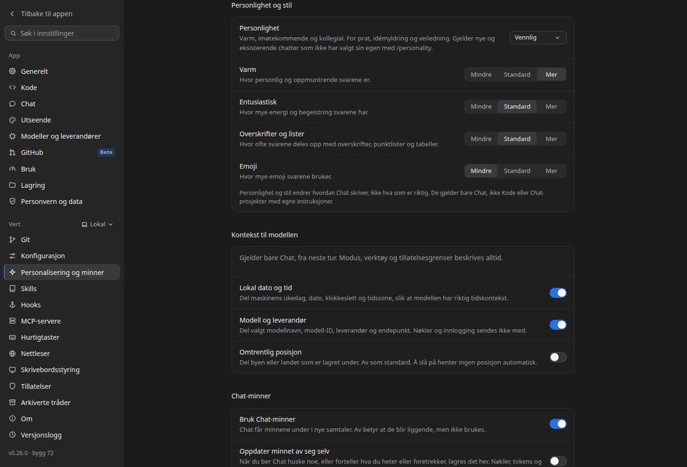

# Personlighet og stil i Chat

Chat har åtte personligheter og fire stilvalg som kan skrus ned eller opp. De endrer hvordan Chat skriver, aldri hva som er riktig, og de gjelder bare Chat. Kode har sine egne arbeidsstiler under `/personality` i en Kode-tråd.

## Personlighetene

| Personlighet | Stil | Passer for |
|---|---|---|
| Standard | Nøytral, balansert og pålitelig | Generelle oppgaver |
| Profesjonell | Nøktern, formell og presis | Jobbrelaterte tekster og formell kommunikasjon |
| Vennlig | Varm, imøtekommende og kollegial | Prat, idémyldring og veiledning |
| Ærlig | Direkte og uten småprat, sier fra når noe er feil eller svakt | Rett svar uten innpakning |
| Spesiell | Kreativ, litt uforutsigbar og leken | Historier, kreativ skriving og lek |
| Nerdete | Går i dybden med detaljer og fagspråk | Faglige dypdykk og tekniske forklaringer |
| Effektiv | Ekstra korte og rette svar | Raske instruksjoner og lister |
| Skeptisk | Realistisk, utfordrer påstander og argumenter | Kritisk sjekk av ideer og planer |

**Standard for alle chatter** velger du i **Innstillinger → Personalisering og minner → Chat → Personlighet og stil**. Valget gjelder nye chatter og eksisterende chatter som ikke har valgt sin egen.

**En enkelt chat** kan velge sin egen med `/personality` i meldingsfeltet, eller under **Innstillinger → Chat → Personlighet for aktiv chat**. «Standard» der betyr at chatten følger standardvalget ditt.

## Stilvalg

Fire kjennetegn kan settes til **Mindre**, **Standard** eller **Mer**:

| Stilvalg | Mindre | Mer |
|---|---|---|
| Varm | Nøytral og saklig tone | Tydelig varmere og mer oppmuntrende |
| Entusiastisk | Rolig og avdempet, uten utropstegn | Mer energi og begeistring |
| Overskrifter og lister | Løpende avsnitt | Overskrifter, punktlister og tabeller |
| Emoji | Ingen emoji | Emoji der de passer |

«Standard» betyr at personligheten bestemmer. Stilvalgene går foran personligheten der de to er uenige, for eksempel Profesjonell med Emoji satt til Mer.

## Slik virker det

Valgene blir til noen korte linjer i instruksen modellen får før hvert svar, sammen med en fast linje om at stil ikke endrer fakta, kode eller sikkerhetsråd. Du kan se den nøyaktige teksten under **Innstillinger → Konfigurasjon → Forhåndsvisning** med modus satt til Chat.

Chat-prosjekter med egne instruksjoner bruker verken personlighet eller stilvalg. Toner og personligheter fra før versjon 0.26 blir oversatt automatisk: Kort blir Effektiv, Grundig og Lærer blir Nerdete, Formell blir Profesjonell og Uformell blir Vennlig.
