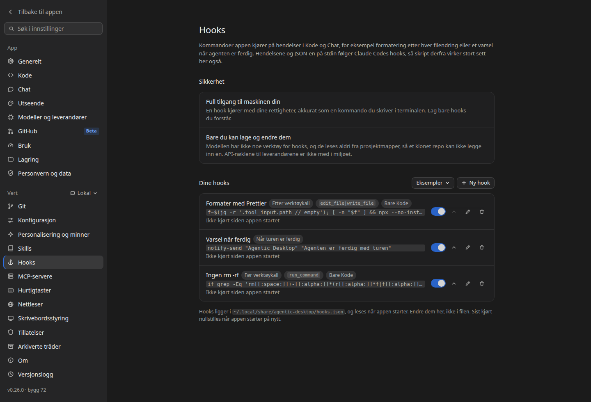

# Hooks

En hook er en kommando som appen kjører når noe skjer i en samtale: før og etter et verktøykall, når du sender en melding, og når agenten er ferdig med turen. Typiske bruksområder er å formatere en fil etter hver endring, sende et skrivebordsvarsel når en lang oppgave er ferdig, eller stoppe kommandoer du aldri vil at agenten skal kjøre.



Åpne **Innstillinger → Hooks**. Der lager, endrer, slår av og sletter du hooks, og ser når hver av dem sist kjørte, avslutningskoden, hvor lang tid den brukte og slutten av utdataene. **Eksempler** åpner en ferdig hook i skjemaet, så du kan lese og endre kommandoen før du lagrer. **Test** kjører kommandoen én gang med en eksempelhendelse og viser avslutningskode, stdout, stderr og hva appen ville gjort med svaret.

Hendelsene og JSON-en på stdin følger Claude Codes hooks, så skript skrevet for Claude Code virker stort sett her også. Forskjellene står nederst.

## Hendelser

| I appen | Navn | Når | Kan stoppe |
| --- | --- | --- | --- |
| Før verktøykall | `PreToolUse` | Etter appens egen godkjenning, rett før verktøyet kjører | Ja, verktøykallet |
| Etter verktøykall | `PostToolUse` | Når verktøyet har kjørt ferdig | Nei, men kan gi modellen tilbakemelding |
| Når du sender en melding | `UserPromptSubmit` | Før meldingen når modellen, også meldinger du sender inn i en tur som kjører | Ja, meldingen |
| Når turen er ferdig | `Stop` | Når agenten er ferdig, også når turen feilet | Nei |

`PreToolUse` kjører etter godkjenningen: avslår du et verktøykall, kjører ikke hooken. Verktøyhooks gjelder agentens verktøykall, ikke `!kommandoer` du skriver selv. `Stop` kjører ikke når du selv trykker **Stopp**, når appen avsluttes midt i en tur, eller når en `UserPromptSubmit`-hook stoppet meldingen.

`UserPromptSubmit` gjelder alle veier en melding kan ta til modellen: den første meldingen i en tur, meldinger du sender inn i en tur som kjører, og meldinger som ligger i køen når du trykker **Stopp**. Ingen melding når modellen før hookene har sluppet den gjennom, og samtalens tittel lages heller ikke av den før da. Blir sjekken avbrutt, fordi du trykker **Stopp** mens hooken kjører, appen avsluttes eller stopper uventet, eller meldingen fortsatt lå i køen da appen startet på nytt, regnes meldingen som ikke sendt. Samtalen sier det, modellen har ikke sett den, og den er heller ikke med når du lager en gaffel eller endrer en tidligere melding. Send den på nytt hvis du vil.

Hver hook gjelder i **Kode**, **Chat** eller begge. Hooks er felles for hele appen i denne versjonen, ikke per prosjekt.

## Verktøyfilter

For `PreToolUse` og `PostToolUse` velger du hvilke verktøy hooken gjelder for:

- tomt eller `*`: alle verktøy
- et navn: `run_command`
- flere navn med `|`: `edit_file|write_file`
- `*` som jokertegn: `mcp__github__*`

Navnet må stemme helt, og store og små bokstaver teller. Filteret sjekkes mot navnet på verktøyet modellen faktisk kalte, så det virker også for verktøy som kommer og går, som MCP-verktøy (`mcp__<tjener>__<verktøy>`). `.*` leses som `*`, så et filter som `mcp__memory__.*` fra Claude Code virker. Andre regex-tegn er vanlige tegn.

Verktøyene i Kode heter blant annet `read_file`, `write_file`, `edit_file`, `delete_file`, `list_dir`, `search`, `glob`, `run_command`, `web_search` og `browser_navigate`. I Chat heter de blant annet `web_search`, `web_fetch`, `create_document`, `list_chat_files` og `run_python`.

## Kommandoen

Kommandoen kjøres med `bash -c`, uten terminal, i prosjektmappen, eller i hjemmemappen når samtalen ikke har noe prosjekt (Chat). Den får samme miljø som andre kommandoer appen starter, uten leverandørenes API-nøkler og appens innloggingsnøkkel, og i tillegg:

| Variabel | Innhold |
| --- | --- |
| `AD_HOOK_EVENT` | Hendelsen, for eksempel `PreToolUse` |
| `AD_HOOK_NAME`, `AD_HOOK_ID` | Hookens navn og ID |
| `AD_HOOK_MODE` | `code` eller `chat` |
| `AD_HOOK_THREAD_ID` | Samtalens ID |
| `AD_HOOK_TOOL_NAME` | Verktøyet, ved verktøyhendelser |
| `AD_HOOK_CWD` | Mappen kommandoen kjører i |
| `AD_PROJECT_DIR`, `CLAUDE_PROJECT_DIR` | Prosjektmappen, når det er et prosjekt |

Tidsgrensen er 30 sekunder som standard og høyst 300. Når den er nådd, stoppes kommandoen og alt den har startet (hele prosessgruppen), og arbeidet går videre. Trykker du **Stopp** i samtalen mens en hook kjører, stoppes hooken med en gang. Flere hooks for samme hendelse kjøres etter hverandre i rekkefølgen på listen; den første som stopper noe, vinner, og resten kjøres ikke.

### Inn: JSON på stdin

Alle hendelser får `hook_event_name`, `session_id` (samtalens ID), `cwd` og `mode`. I tillegg:

- `PreToolUse`: `tool_name`, `tool_input`, `tool_use_id`
- `PostToolUse`: det samme, og `tool_response` med `content` (verktøyresultatet som tekst) og `is_error`
- `UserPromptSubmit`: `prompt`, meldingen slik den vises i samtalen
- `Stop`: `status` (`done` eller `error`), `error` når turen feilet, `last_assistant_message` og `stop_hook_active` (alltid `false`)

Lange tekster i stdin kortes ned til 100 000 tegn.

```json
{"hook_event_name":"PreToolUse","session_id":"6f1c…","cwd":"/home/deg/prosjekt","mode":"code","tool_name":"run_command","tool_input":{"command":"npm test"},"tool_use_id":"call_1"}
```

### Ut: avslutningskode og stdout

| Kode | `PreToolUse` | `PostToolUse` | `UserPromptSubmit` | `Stop` |
| --- | --- | --- | --- | --- |
| 0 | Verktøyet kjører | Ingen endring | Stdout legges til som kontekst for modellen | Ingen endring |
| 2 | Verktøyet kjører ikke; stderr går til modellen som verktøyets feil | Stderr legges til i verktøyresultatet som tilbakemelding | Meldingen sendes ikke; stderr vises for deg | Vises som en feil |
| Annen | Feil som vises for deg; verktøyet kjører | Feil som vises | Feil som vises; meldingen sendes | Feil som vises |

Ved kode 0 kan stdout også være et JSON-objekt:

- `{"decision": "block", "reason": "…"}` stopper verktøykallet eller meldingen, som kode 2. For `PostToolUse` blir `reason` tilbakemelding til modellen.
- `{"additionalContext": "…"}` legger til kontekst (`UserPromptSubmit`) eller tilbakemelding (`PostToolUse`). `hookSpecificOutput.additionalContext` virker også.
- `{"hookSpecificOutput": {"permissionDecision": "deny", "permissionDecisionReason": "…"}}` stopper et verktøykall, som i nyere Claude Code.

Andre felter overses.

### Synlig i samtalen

Når en hook stopper noe, gir tilbakemelding eller kontekst, eller feiler, får den en egen linje i samtalen med navnet sitt og det den skrev. Det modellen får fra en hook, er merket med hookens navn og med at det kommer fra et lokalt skript du har satt opp, ikke fra deg. Hooks som bare kjørte, vises i Innstillinger, ikke i samtalen.

## Eksempler

Formater filen agenten skrev eller endret (`PostToolUse`, verktøy `edit_file|write_file`, Kode). Bruker `jq` og prosjektets egen Prettier:

```bash
f=$(jq -r '.tool_input.path // empty'); [ -n "$f" ] && npx --no-install prettier --write "$f" >/dev/null 2>&1 || true
```

Skrivebordsvarsel når agenten er ferdig (`Stop`, Kode og Chat):

```bash
notify-send "Agentic Desktop" "Agenten er ferdig med turen"
```

Stopp `rm -rf` i kommandoer (`PreToolUse`, verktøy `run_command`). Modellen får begrunnelsen og kan velge en annen vei:

```bash
if grep -Eq 'rm[[:space:]]+-[[:alpha:]]*(r[[:alpha:]]*f|f[[:alpha:]]*r)'; then echo "rm -rf er sperret av en hook. Slett filer enkeltvis, eller spør brukeren." >&2; exit 2; fi
```

Legg til gjeldende Git-gren i hver melding (`UserPromptSubmit`, Kode):

```bash
echo "Gjeldende gren: $(git branch --show-current 2>/dev/null)"
```

## Sikkerhet

- **En hook har full tilgang til maskinen din.** Den kjører med dine rettigheter, akkurat som en kommando du skriver i terminalen. Den er ikke avgrenset til prosjektmappen og går ikke gjennom appens tillatelser. Lag bare hooks du forstår.
- **Bare du kan lage og endre hooks**, i Innstillinger, gjennom appens innloggede API. Modellen har ikke noe verktøy for hooks.
- **Hooks leses aldri fra prosjekter.** Et klonet repo med `.claude/settings.json`, `.agentic/` eller lignende kan ikke legge inn en hook. Hooks ligger i `hooks.json` i appens datamappe, og filen leses når appen starter. Endre dem i Innstillinger, ikke i filen.
- **Modellen kan ikke nå `hooks.json` med filverktøyene**, som nekter alt i datamappen. En kommando fra modellen (`run_command`) som nevner datamappen eller den globale konfigurasjonsmappen, spør deg alltid først, også med Full tilgang, og kan ikke godkjennes for alltid. Det gjelder den vanlige stien, `~/…`, `$HOME/…`, `${HOME}/…`, `$XDG_DATA_HOME/…` og `$XDG_CONFIG_HOME/…`, og appens egne filer ved navn (`agentic-desktop/hooks.json`, databasen, `keys.json`). **Dette er en enkel tekstsjekk, ikke en sandkasse.** Den fanger ikke en sti som bygges mens kommandoen kjører, for eksempel med variabler, jokertegn, `cd` og en relativ sti, eller et skript som skriver filen. En modell med Full tilgang kan derfor i prinsippet fortsatt endre `hooks.json`, og en slik endring virker fra neste oppstart. Bruk **Spør** eller **Godta redigeringer** i prosjekter du ikke stoler på.
- **API-nøklene til leverandørene er ikke med** i miljøet hooken får, akkurat som for andre kommandoer appen starter.
- **Det en hook sender tilbake til modellen, er data fra et lokalt skript.** Det kortes ned til 8 000 tegn per hook og merkes med hookens navn. Skriver et skript innhold det har hentet fra nettet eller fra filer, er det like lite til å stole på som annet innhold modellen leser.
- `.git/hooks` i prosjekter er noe annet: Git sine egne hooks. Appen beskytter dem fortsatt, og agentens endringer i dem krever alltid godkjenning.

## Grenser

- Maks 50 hooks, 4 000 tegn per kommando, 80 tegn i navnet og 500 i verktøyfilteret.
- Tidsgrense 1–300 sekunder, standard 30.
- Inntil 8 000 tegn per hook går tilbake til modellen, og inntil 2 000 vises i samtalen og i Innstillinger.
- «Sist kjørt» huskes til appen starter på nytt.
- Kommandoen kjører uten terminal, så noe som venter på tastetrykk, stopper ved tidsgrensen.

## Forskjeller fra Claude Code

- Fire hendelser: `PreToolUse`, `PostToolUse`, `UserPromptSubmit` og `Stop`. `SessionStart`, `Notification`, `SubagentStop`, `PreCompact` og de andre finnes ikke.
- `Stop` kan ikke tvinge agenten til å fortsette; `decision: "block"` og kode 2 er uten virkning der.
- `PreToolUse` kan ikke godkjenne et kall på forhånd eller endre argumentene. Appens egen godkjenning kommer først, så kan hooken bare stoppe.
- `PostToolUse` kjører også når verktøyet returnerte en feil, med `is_error: true`. Claude Code har en egen hendelse for det.
- Verktøyene har appens navn (`edit_file`, `run_command`), ikke Claude Codes (`Edit`, `Bash`), og argumentene deres: filstien heter `path`, ikke `file_path`.
- Filteret er navn, `|` og `*`, ikke et fullt regulært uttrykk.
- Hooks settes opp i Innstillinger og er globale. De leses aldri fra `settings.json` i prosjekter eller i hjemmemappen, og det er ingen `transcript_path`.
- Felter som `continue`, `stopReason`, `suppressOutput` og `systemMessage` overses.
