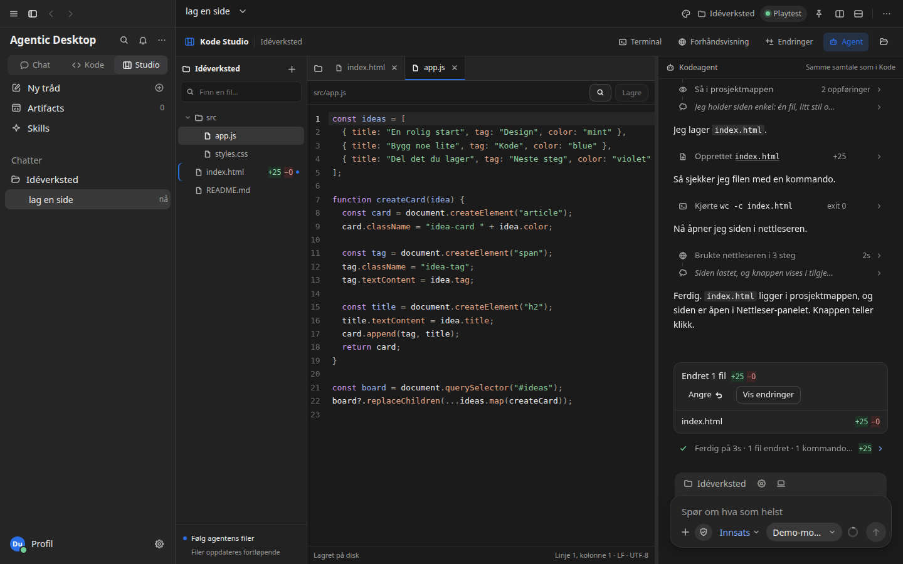
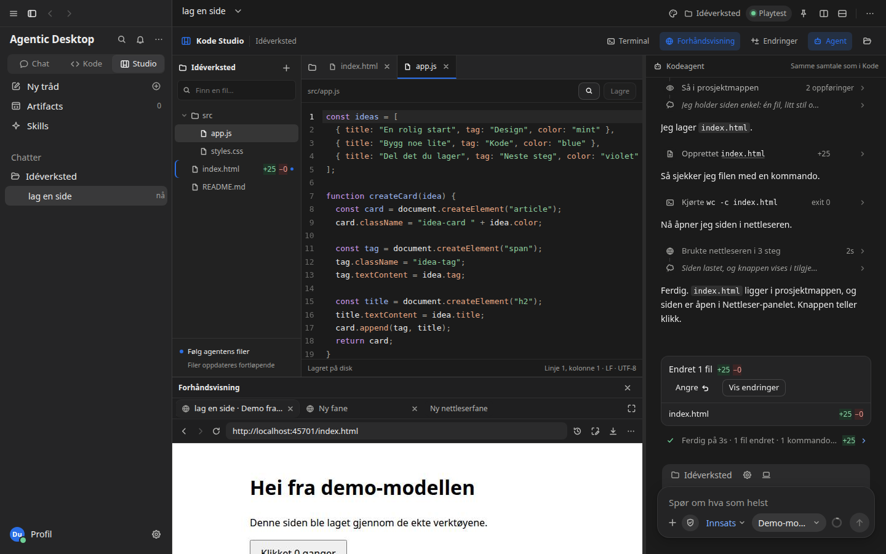
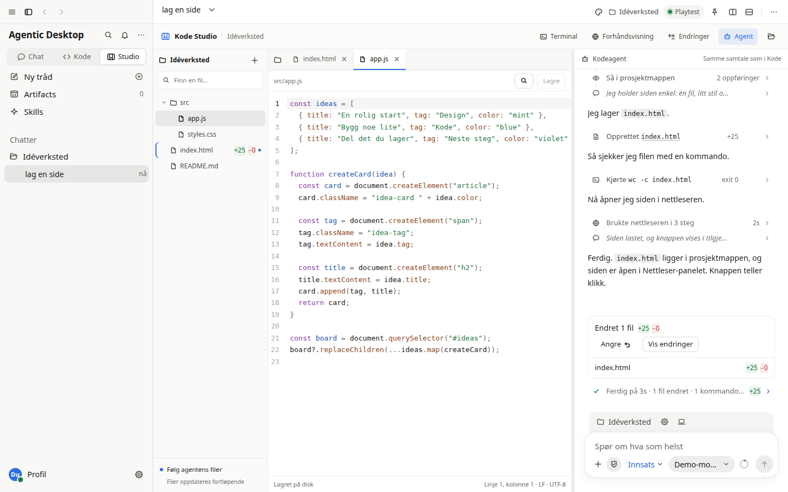

# Kode Studio

**Kode Studio** samler prosjektfiler, en redigerbar kodeeditor med faner og kodeagenten på én arbeidsflate. Studio bygger direkte på de eksisterende **Kode**-trådene, så modeller, verktøy, godkjenninger og prosjektgrenser er de samme som i vanlig Kode.

## Forholdet til Kode, Filer-panelet og mini-editoren

- **Kode** er samtale-først, med et valgfritt sidepanel til høyre. **Filer**-panelet viser filstruktur og skrivebeskyttet forhåndsvisning, og **mini-editoren** åpnes som et hurtigvindu for rask redigering, symboloversikt eller diff på én fil.
- **Kode Studio** er fil- og editor-først, for lengre arbeid på tvers av flere filer samtidig med kodeagenten rett ved siden av. Fra **Filer**-panelet i Kode kan du klikke **Studio** på en åpen fil for å fortsette redigeringen i Kode Studio.

## Kom i gang

Velg **Studio** i modusvelgeren øverst i sidefanen (eller ikonraden), åpne **Vis → Kode Studio**, bruk kommandopaletten (`Ctrl+K`) eller bytt modus med `Ctrl+Shift+M`.

Velg deretter et eksisterende prosjekt eller åpne en ny prosjektmappe. Uten valgt prosjekt viser startsiden i Studio prosjektene dine og en snarvei til mappevelgeren.

## Funksjoner

- **Prosjektfiler:** Bla i mappestrukturen, filtrer etter filnavn og se linjeendringer (`+N -M`) fra aktiv tråd. Klikk **+** for å opprette en ny tekstfil; eksisterende filer overskrives ikke, og foreldremappen må finnes fra før. Trykk `Esc` for å avbryte.
- **Editor med faner:** Åpne flere filer samtidig med syntaksfarger, linjenummer, innrykk (`Tab` / `Shift+Tab`), angre/gjør om (`Ctrl+Z` / `Ctrl+Shift+Z` / `Ctrl+Y`), søk i fil (`Ctrl+F` med treffteller, `Enter` / `Shift+Enter` og `Esc`) og lagring (`Ctrl+S`). Piltaster, `Home`, `End` og `Delete` virker på filfanene.
- **Kodeagent side om side:** Den samme Kode-samtalen som i vanlig Kode vises ved siden av editoren. Bytte mellom Kode og Kode Studio oppretter ingen ny tråd. Dra skillet, bruk piltaster/`Home`/`End` på skillet, eller skjul agenten med **Agent**-knappen (`Ctrl+Shift+B`). På smale vinduer bytter du mellom **Filer og editor** og **Kodeagent**.
- **Følg agentens filer:** Nye og endrede filer fra agenten åpnes fortløpende når de er skrevet til disken, uten å erstatte et aktivt ulagret utkast. Slå av **Følg agentens filer** nederst i filutforskeren hvis du vil styre filvalget selv.
- **Verktøydokk:** **Terminal**, **Forhåndsvisning** (nettleser) og **Endringer** åpnes i en dokk under editoren og gjenbruker appens eksisterende terminaløkter, Playtest-nettleser og diff-visning.

## Samtidige endringer og konflikter

Lagrede filer i editoren oppdateres automatisk når agenten, terminalen eller en ekstern editor endrer dem. Hvis du har ulagrede endringer i fanen, beholdes utkastet ditt og en konfliktmelding lar deg:

- **Last inn fra disk** (etter bekreftelse),
- **Vis diskversjon** for å sammenligne og eventuelt godta det redigerte utkastet for neste lagring,
- **Lagre på nytt** dersom filen ble slettet på disken mens du redigerte den, eller
- **Behold utkast** for å fortsette redigeringen i fred.

Ulagrede utkast beholdes når du bytter mellom faner, prosjekter eller mellom Kode og Kode Studio, og holdes adskilt hvis prosjektmappen flyttes. Vinduet varsler før lukking hvis du har ulagrede utkast, men utkast i minnet erstatter ikke vanlig lagring til disk.

## Filovervåking og avgrensning

Studio overvåker bare prosjektroten, utvidede mapper og foreldremappene til åpne filer (opptil 64 mapper per klient og 512 delte mapper per server), uten rekursiv gjennomgang av hele disken. `.git`, `node_modules`, beskyttede stier og appens datamappe overvåkes ikke, og overvåking stoppes når arbeidsflaten skjules eller lukkes.

Beskyttede filer (som `.env`), binærfiler og svært store filer åpnes skrivebeskyttet eller vises med tydelig beskjed. Kode Studio er en lettvekts arbeidsflate bygget på CodeMirror og appens egne verktøy – språkservere (LSP), debugger og VS Code-utvidelser inngår ikke.

## Flere visninger

| Forhåndsvisning i dokk | Lyst tema |
|---|---|
|  |  |
