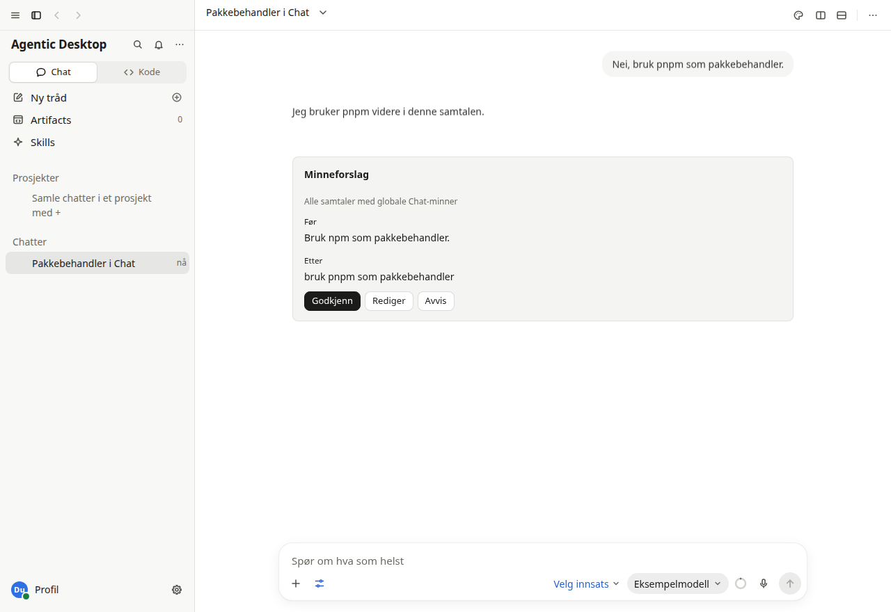

# Minneforslag i Chat og Kode

I Chat kan du slå på **Bruk Chat-minner** og **Oppdater minnet av seg selv** under **Innstillinger → Personalisering og minner**. Et Chat-prosjekt har sin egen bryter og sitt eget valg mellom prosjektminner og delte globale Chat-minner. `/memories` åpner innstillingene for det aktuelle området.

Hvis et minne sier «Bruk npm» og du skriver «Nei, bruk pnpm i dette prosjektet», vises et forslag etter en fullført tur. Sjekk området øverst i kortet. **Rediger** lar deg velge hvilken linje det gjelder og skrive om teksten. **Godkjenn** lagrer den. **Avvis** fjerner forslaget. Hvis noen redigerte minnet mens kortet ventet, må du velge på nytt hvilken tekst som skal erstattes. Du kan komme tilbake til et ubesvart forslag etter omstart. Bytte av prosjekt eller prosjektets minneområde gjør gamle forslag ugyldige.

Modeller med verktøystøtte kan foreslå varige rettelser med et sitat fra den siste brukermeldingen de mottok i turen. Enkle norske og engelske rettelser gjenkjennes også med lokale regler. Kjente formuleringer for navn og uttalte preferanser kan fremdeles lagres automatisk. Filstier med punktum bevares. Filtrene for hemmeligheter og midlertidig status bruker tekstmønstre. Stoppede turer og midlertidige chatter oppretter ingen forslag.

Chat-minnene lagres i konfigurasjonsmappens `chat/MEMORY.md` eller i prosjektets minnetabell. Ventende forslag ligger i appens lokale SQLite-database, knyttet til tråden. Neste modelltur kan bruke godkjent kunnskap. Prosjektinstruksjoner i Kode ligger i `AGENTS.md`. Globale og prosjektlokale Kode-minner bruker sine egne `MEMORY.md`-filer. Ordningen er inspirert av [Claude Codes skille mellom prosjektinstruksjoner og automatisk hukommelse](https://code.claude.com/docs/en/memory).

## Verifisering og prosedyrer i Kode

Etter en kodeendring kjenner appen igjen prosjektets oppdagede kontrollkommandoer, enkeltvis eller i kjeder med `&&`. Agenten kan forklare et målrettet testresultat eller rapportere hvorfor verifisering gjenstår. Påminnelser om manglende eller mislykket kontroll er avgrenset per tur.

Når en prosedyre bør rettes, kan modellen foreslå å erstatte én entydig passasje i en redigerbar bruker- eller prosjektskill. Se filnavn, før og etter i godkjenningskortet. Hver endring må godkjennes, også i Full tilgang, og godkjenningen gjelder bare den filversjonen du så. App-skills er skrivebeskyttet. Slår du av **Skills fra agenten**, skjules begge forslagstypene i Kode.
