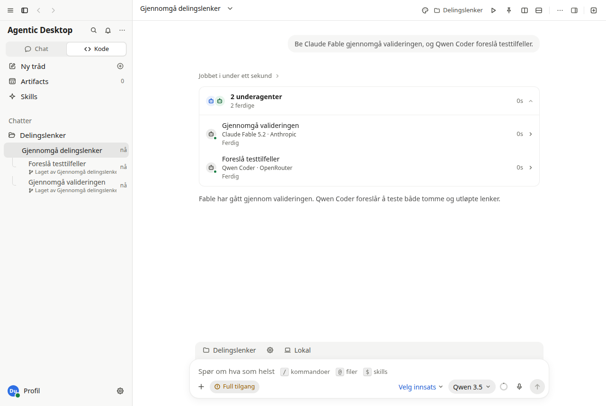

# Ulike modeller i samme kodeoppgave

1. Legg til modellene du har tilgang til under **Modeller og leverandører**. Velg hovedmodellen i en Kode-tråd i prosjektet.
2. Gi hovedmodellen et oppdrag, for eksempel «Be Fable hos Anthropic gjennomgå valideringen, og be en annen Qwen-modell hos OpenRouter foreslå testtilfeller. Sammenlign svarene.» Bruk navn som finnes i dine innstillinger.
3. Åpne underagentkortet i samtalen. Hver rad viser oppgave, tildelt modell, leverandør og status. Klikk på raden for å åpne hjelpetråden. Modell og leverandør i dette kortet er valget ved oppstart, også hvis du senere bytter modell i hjelpetråden.

Hovedagenten kan søke med `thread_models` og gi `thread_create` den nøyaktige ID-en. Søket viser lokalt konfigurerte modeller, med opptil tolv treff per side. Det kontakter ingen leverandør. Et entydig visningsnavn eller API-modellnavn fungerer også. Ved navnekollisjon må agenten velge en ID. Uten eksplisitt modellvalg arver hjelperen modellen fra hovedmodellens pågående kjøring. Hjelpetråder krever et Kode-prosjekt og kan ikke startes i planmodus eller på «Denne datamaskinen».

Delegering til en annen leverandør krever en egen godkjenning, også i Full tilgang. Kortet forteller hvem som får oppgaven og prosjektkonteksten. Et avslag starter ingen hjelpetråd. Stopp før godkjenning eller en styringsmelding før oppstart hindrer også at hjelperen starter. Hjelpere som allerede er i gang, kan stoppes i egne tråder eller med Stopp alt.

Modellen som delegerer trenger støtte for verktøykall. En hjelper som skal lese filer, redigere eller kjøre tester, trenger også verktøystøtte. Tilgang og modellnavn følger brukerens leverandørkontoer. Oppstartsmeldingen til hjelperen inneholder oppgavebeskrivelsen og avsenderens tråd-ID, ikke tittelen på avsendertråden. Hjelperen kan bruke prosjektets vanlige verktøy til å lese mer kontekst når oppgaven krever det. Hjelperne arbeider parallelt i den samme prosjektmappen, så gi skriveoppgaver forskjellige filer. Prosjektets tillatelser og grenser for dybde og samtidighet gjelder som før.
