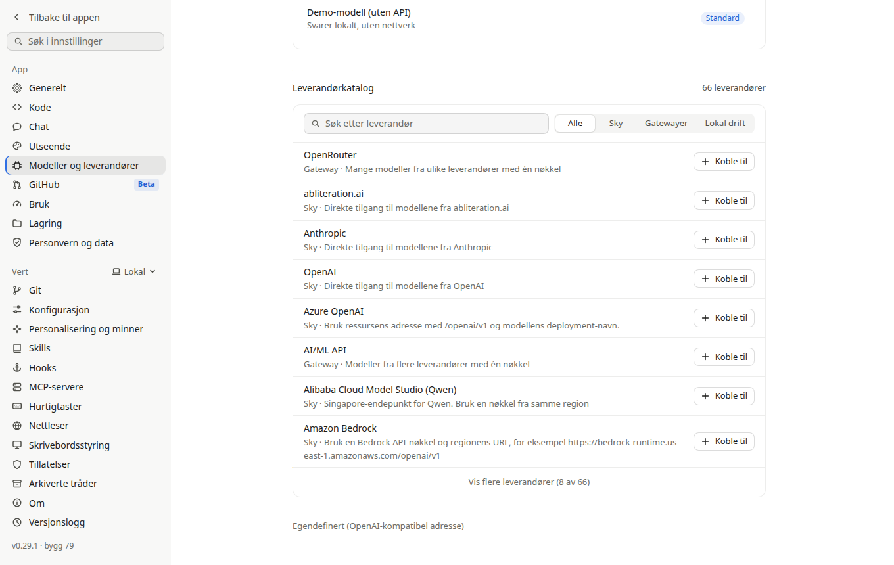

# Modellleverandører i Agentic Desktop

Åpne **Innstillinger → Modeller og leverandører → Koble til leverandør**. Søk på navnet eller bruk filtrene **Sky**, **Gatewayer** og **Lokal drift**. Katalogen har 66 forhåndsvalg. **Egendefinert oppsett** bruker samme flyt for en egen OpenAI-kompatibel adresse, en lokal modellserver eller et Anthropic-endepunkt.

## Koble til og velg modell

- **Sky og gatewayer.** Bruk en nøkkel fra tjenesten du velger. Google Gemini, xAI, Mistral, Groq, DeepSeek, Hugging Face og Vercel AI Gateway har ferdig utfylte adresser. For tjenester som Azure OpenAI, Amazon Bedrock og Cloudflare Workers AI oppgir du adressen til din ressurs. Oppsettet lenker til leverandørens dokumentasjon.
- **Lokal drift.** Start modellserveren og last en modell der. Velg for eksempel Ollama, LM Studio, llama.cpp eller vLLM, og kontroller adressen. Hvis serveren ikke krever en nøkkel, lar du nøkkelfeltet stå tomt. Forhåndsvalget installerer ingen modellserver.
- **Modeller.** Agentic Desktop henter modellisten der API-et tilbyr den. Du kan også velge **Skriv inn modell-ID** hvis listen mangler eller ønsket modell er borte. På Azure bruker du navnet du ga modellen ved utrulling.

Etter oppsett velger du modellen i meldingsfeltet. Du kan angi en standardmodell for nye tråder på samme innstillingsside.

## Finn en lokal server

**Finn lokale servere** sjekker bare standardadressene på denne maskinen, uten nøkler og uten å starte generering. Ollama sjekkes på port `11434`, LM Studio på `1234`, llama.cpp på `8080` og vLLM på `8000`. En kompatibel modelliste på en delt port bekrefter at et API svarer, ikke hvilket program som kjører det.

Bruk katalogen også for servere med nøkkelkrav, en annen port eller en adresse på lokalnettet. Legg inn adressen til serveren, for eksempel `http://192.168.1.20:1234/v1`, og velg **Fortsett**. Bruk HTTPS når nøkkelen eller samtaleinnholdet må krypteres underveis. Appen følger ikke API-videresendinger og tar ikke med den lagrede nøkkelen når du endrer adresse. Innhold sendes til endepunktet du velger; hvis serveren videresender til skyen, følger det serverens oppsett.

Lokale modeller får rapportert kontekst når serveren oppgir den, ellers **4096 tokens**. Sett **Kontekstvindu** til det serveren faktisk bruker; modellens maksimum kan være større. Appen leser aktiv kontekst og støtte for bilder og verktøy fra Ollama og LM Studio når metadata er tilgjengelig. Du kan endre disse innstillingene under **Rediger**.

## Kontroller oppsettet

**Test tilkobling** sjekker modellisten. **Test modell** på en lagret lokal modell eller en leverandør med manuell modell-ID sender en kort testmelding. Det kan laste den lokale modellen i minnet eller bruke leverandørens saldo eller kvote. For lokale modeller med verktøy på kontrolleres et strukturert testkall uten å utføre det.

Støtte for verktøykall, bilder, tenkeinnsats og nettsøk varierer med modell og endepunkt. Ukjent verktøystøtte betyr **Verktøy av** for lokale modeller. Du kan slå på **Verktøykall** under **Rediger** når både modellen og serverens oppsett støtter det. Filendringer, terminal og nettleserstyring i Kode krever verktøykall og bruker de vanlige prosjektgrensene og godkjenningene. Tekst som ligner et verktøykall blir ikke utført.

API-nøkkelen lagres i systemets nøkkelring. Hvis nøkkelringen er utilgjengelig, beholdes nøkkelen i minnet til appen lukkes. Nye oppføringer er satt opp fra leverandørenes offentlig dokumenterte API-er. Lokale prøveservere dekker tilkoblingsflyten.

## Anbefal en lokal modell

Velg **Anbefal modell** i katalogen, deretter **Chat** eller **Kode** og ønsket kontekst. Velg **Denne maskinen** for å bruke målt tilgjengelig RAM og eventuelt ledig GPU-minne. For en server på en annen maskin velger du **Oppgi minne selv**. Oppgi ledig GPU-minne for ett kort, ikke summen av alle kortene.

Du får opptil tre forslag med lenker til Ollama og en konkret GGUF-kvantisering. Anslaget inkluderer modellvekter, kontekst og kjøremotor, med minst 4 GiB system-RAM i reserve. Hvis ledig GPU-minne ikke kan måles, vises bare RAM-alternativer. Anbefalingen måler ikke hastighet, laster ikke ned vekter og starter ingen server. Installer modellen i serveren selv, sett konteksten der og velg **Hent modeller** for å bruke den i appen.

Anbefalingene bygger på en innebygd katalog, blant annet [Qwen3.8 27B](https://ollama.com/library/qwen3.8/tags), [Gemma 4 12B](https://huggingface.co/ggml-org/gemma-4-12B-it-GGUF) og [Qwen3.5](https://ollama.com/library/qwen3.5). En annen kvantisering, bilder eller flere samtidige forespørsler kan øke minnebruken.
