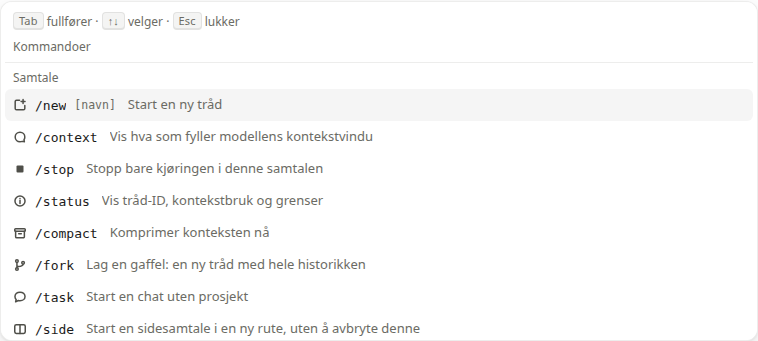

# Kommandoer og skills i Agentic Desktop

Skriv `/` først i meldingsfeltet for å finne kommandoer og skills for den aktive modusen. Navn og aliaser kan skrives med store eller små bokstaver. Bruk piltastene for å velge, **Tab** for å fullføre navnet og **Enter** for å bruke valget. **Esc** lukker menyen. `/commands` og `/help` åpner den søkbare guiden. `/help export` finner for eksempel `/save` via aliaset.



## Chat og Kode

| Oppgave | Kommandoer |
|---|---|
| Åpne og organisere tråder | `/new [navn]`, `/sessions [søk]` (også `/resume`), `/title [ny tittel]`, `/pin [on\|off]`, `/archive [on\|off]`, `/snooze <1h\|tomorrow\|week\|off>` |
| Lese eller dele samtalen | `/find` søker i denne tråden. `/copy markdown` kopierer hele samtalen, `/copy last` siste svar og `/copy id` tråd-ID-en. `/save` laster ned en Markdown-fil. |
| Arbeide parallelt | `/side` åpner en sidesamtale. `/fork` (også `/branch`) kopierer tråden. `/fork-last` tar med siste melding og svaret. `/window` løsriver tråden. |
| Bruke modellen | `/model [navn]`, `/reasoning [nivå]`, `/context`, `/compact`, `/status`, `/stop`, `/btw <spørsmål>`, `/bg <oppgave>` |
| Håndtere meldinger mens modellen jobber | `/queue` og `/queue list` viser ventende meldinger. `/queue <melding>` legger meldingen bakerst, og `/queue add list` legger bokstavelig «list» i køen. `/steer <melding>` sender ved neste steg. `/busy status` viser standardvalget, og `/busy queue` og `/busy steer` endrer det for nye sendinger og justerer dine ventende meldinger i denne tråden. |
| Finne appverktøy | `/palette [søk]`, `/skills`, `/artifacts`, `/mcp`, `/usage`, `/version`, `/settings`, `/config`, `/shortcuts`, `/theme [lys\|mørk\|system]` |

I **Chat** åpner `/tools` verktøyene for samtalen. `/retry` ber om bekreftelse før siste svar erstattes, og `/temporary` starter en midlertidig samtale fra vanlig Chat.

I **Kode** åpner `/files`, `/terminal`, `/browser`, `/session`, `/overview` og `/panel` visninger i sidepanelet. `/terminal ny` og `/browser ny` åpner en ny fane. Med et prosjekt kan du også bruke `/diff`, `/agents` (også `/tasks`), `/worktree`, `/branches`, `/github`, `/project-settings`, `/project-sources` og `/playtest start` eller `/playtest stop`. `/plan on`, `/plan off` og `/plan status` styrer eller viser planmodus.

Kommandoer som søker, åpner visninger eller endrer appinnstillinger håndteres i appen. `/retry`, `/btw`, `/bg`, `/compact` og meldingene du sender med `/queue` eller `/steer` bruker modellfunksjonene du allerede har valgt.

## Følg en kjøring eller pull request

- `/babysit` eller `/babysit task` følger kjøringen som er aktiv i denne tråden. Appen varsler når den er ferdig, stoppet, avbrutt eller feiler.
- `/babysit pr https://github.com/eier/repo/pull/14` følger PR-status, CI og kodegjennomgang. Bruk `/babysit pr #14` som snarvei i et Kode-prosjekt med en GitHub-remote. GitHub må være koblet til i Innstillinger med lesetilgang til PR-en og sjekkene.
- `/babysit status` viser siste status. `/babysit stop` avslutter oppfølgingen. GitHub-sjekken går omtrent hvert minutt til PR-en flettes eller lukkes. Du kan følge ett mål per appvindu mens vinduet er åpent, også når du bytter tråd.

Oppfølgingen bruker lokal kjørestatus eller GitHubs status-API. Den starter ingen modelltur og gjør ingen endringer på GitHub.

## Bruke en skill

Skriv `/review området som skal vurderes` direkte, eller velg skillen i menyen og skriv argumentene etter brikken. Fuzzy-søk fungerer i feltet, for eksempel `/rvw` for `/review`. Skriv `$` for bare skills. Hvis en innebygd kommando har samme navn eller alias, kan du fortsatt nå skillen med `$navn`.

## Filformat

Legg hver skill i `skills/<navn>/SKILL.md`, enten i appmappen eller i prosjektmappen:

```markdown
---
name: review
description: Gå gjennom kode før den tas i bruk.
args: "[fil eller område]"
---
Gå gjennom dette uten å endre filer: {{args}}
```

`name` og `description` er påkrevd tekst. `args` er valgfri tekst som beskriver argumentene i menyen. `mode: code` eller `mode: chat` er valgfritt og begrenser skillen til den modusen; uten feltet tilbys den i begge. Kroppens `{{args}}` erstattes bokstavelig med friteksten etter kommandoen; mellomrom, linjeskift og tegn som `$&` beholdes. Ugyldige metadata gir advarsel i serverloggen og filen hoppes over.

Prosjektets skills vinner over globale skills. Eksisterende `.agentic/skills/`, `.claude/skills/`, `.agents/skills/` og brukerens konfigurasjonsmappe støttes fortsatt. Appens medfølgende skills kan vises, men ikke endres gjennom Innstillinger. Lag en egen variant med samme navn for å overstyre dem.

## Hvordan instruksjonene brukes

Bare kommandoen og argumentene vises i chatloggen. Skill-kroppen legges i systeminstruksen for den aktuelle turen; den kopieres ikke til senere brukermeldinger eller komprimeringssammendrag. Valget tas som et øyeblikksbilde ved innsending, også når meldingen står i kø. En skill gir ingen ekstra verktøy eller tillatelser.

Mapper leses ved oppstart og kontrolleres for filendringer hvert halve sekund. Oppretting, endring, editorens atomiske lagring og sletting oppdaterer åpne kommandomenyer uten omstart.

## Innebygde skills

Appen har 29 innebygde skills. Sju fungerer i både Chat og Kode. De øvrige 22 er laget for Kode.

| Skill | Bruk |
|---|---|
| `/source-brief` | Sammenlign kilder og knytt hver konklusjon til en lenke eller passasje (Chat og Kode) |
| `/action-items` | Hent beslutninger, avtalte oppgaver, ansvar og frister fra notater (Chat og Kode) |
| `/analyze-data` | Forklar tall i en tabell med kontrollerbare beregninger (Chat og Kode) |
| `/benchmark` | Mål en operasjon flere ganger under like forhold og oppgi variasjonen |
| `/ci-triage` | Spor en rød CI-jobb til riktig kjøring, forsøk og feilmelding |
| `/excel` | Excel-filer med flere ark, typede celler og kontrollerte formler (Chat og Kode) |
| `/word` | Word-dokumenter med tekst, overskrifter, punktlister og tabeller (Chat og Kode) |
| `/powerpoint` | PowerPoint med tydelige lysbilder og presentatørnotater (Chat og Kode) |
| `/data-files` | Markdown, tekst, CSV og JSON med bevarte data (Chat og Kode) |
| `/debug` | Finn og rett årsaken til en feil systematisk |
| `/tdd` | Lag en endring test-først |
| `/review` | Kodegjennomgang uten å endre filer |
| `/verify` | Kontroller egne endringer før noe kalles ferdig |
| `/plan-change` | Planlegg en større endring før koden skrives |
| `/refactor` | Endre struktur uten å endre oppførsel |
| `/explore` | Bli kjent med en ukjent kodebase |
| `/git` | Trygg arbeidsflyt for git og GitHub |
| `/web-qa` | Test en nettside i appens nettleser |
| `/security-audit` | Sikkerhetsgjennomgang med konkrete rettinger |
| `/docs` | Skriv dokumentasjon som stemmer med koden |
| `/frontend-design` | Lag gjennomarbeidede brukergrensesnitt |
| `/gauntlet-loop` | Intensiv runde med bygging, kritikk og forbedring |
| `/skill-creator` | Lag eller forbedre en skill i Agentic Desktop |
| `/memory` | Lær av rettelser og husk varige fakta i MEMORY.md |
| `/sol-loop` | Kjør en avgrenset kodegjennomgang med GPT Sol (manuell) |
| `/council` | Få uavhengige vurderinger fra tre modelltilbydere (manuell) |
| `/interface-recreation` | Gjenskap et grensesnitt fra en godkjent referanse (manuell) |
| `/handoff` | La hovedagenten fordele oppgaver og samle korte resultater (manuell) |
| `/performance-optimization` | Mål, finn flaskehalsen og verifiser en avgrenset ytelsesendring (manuell) |

Skriv `$` i meldingsfeltet for å vise bare skills.

Manuelle skills vises i menyen, men lastes ikke automatisk. Velg en manuelt, eller start meldingen med for eksempel `Bruk council skill` eller `Use the council skill`. Et løst navn er ikke nok. For egne skills setter `disable-model-invocation: true` i YAML-hodet samme regel.


Du kan for eksempel skrive `/action-items Hvem påtok seg hva i referatet over?` eller `/analyze-data Hva forklarer endringen fra september til oktober i vedlagte salg.csv?`. Nettverktøy og Python kan brukes når de er tilgjengelige i samtalen. Med nett slått av kan `/source-brief` sammenligne tekster du limer inn. I Kode kan `/ci-triage` også bruke et loggutdrag du har gitt den.

I Chat-prosjekter tilbys bare innebygde app-skills som støtter Chat. Globale bruker-skills og Kode-skills holdes utenfor; prosjektets egne instruksjoner gjelder fortsatt. Vanlig Chat kan bruke globale skills for Chat/begge moduser.

Modellen får lista med navn og beskrivelse i systeminstruksen og blir bedt om å laste en passende skill med `use_skill` før den begynner på en oppgave. Når minner og skill-forslag er slått på, peker instruksen også på `memory` og `skill-creator`, slik at rettelser blir til minner i `MEMORY.md` og gjentakbare framgangsmåter blir til nye skills. Hver skill er én fil; appen laster ikke tilleggsfiler fra skill-mappen.

`/review` velger den innebygde skillen. Appens tidligere gjennomgang av trådens registrerte filendringer er tilgjengelig som `/review-changes`. Når ingen review-skill finnes, beholdes `/review` som alias for den innebygde funksjonen.
