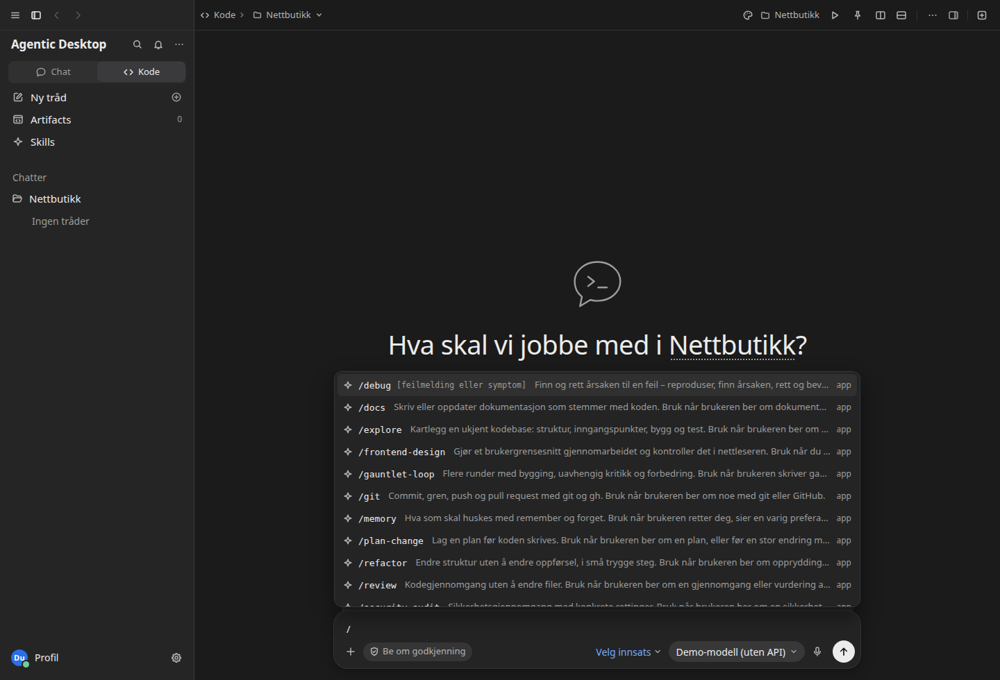
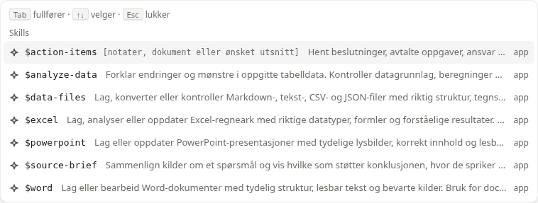

# Slash-skills i Agentic Desktop

Skriv `/` først i meldingsfeltet for å vise kommandoer og skills. Skriv videre for fuzzy-søk, bruk opp/ned og Enter for å velge, og Esc for å lukke. `/rvw` finner for eksempel `/review`. Du kan også skrive `/review området som skal vurderes` direkte. Valg fra menyen legger skillen som en brikke, så du kan skrive argumentene etterpå.



## Filformat

Legg hver skill i `skills/<navn>/SKILL.md`, enten i appmappen eller i prosjektmappen:

```markdown
---
name: review
description: Gå gjennom kode før den tas i bruk.
args: "[fil eller område]"
---
Gå gjennom dette uten å endre filer: {{args}}
```

`name` og `description` er påkrevd tekst. `args` er valgfri tekst som beskriver argumentene i menyen. `mode: code` eller `mode: chat` er valgfritt og begrenser skillen til den modusen; uten feltet tilbys den i begge. Kroppens `{{args}}` erstattes bokstavelig med friteksten etter kommandoen; mellomrom, linjeskift og tegn som `$&` beholdes. Ugyldige metadata gir advarsel i serverloggen og filen hoppes over.

Prosjektets skills vinner over globale skills. Eksisterende `.agentic/skills/`, `.claude/skills/`, `.agents/skills/` og brukerens konfigurasjonsmappe støttes fortsatt. Appens medfølgende skills kan vises, men ikke endres gjennom Innstillinger. Lag en egen variant med samme navn for å overstyre dem.

## Hvordan instruksjonene brukes

Bare kommandoen og argumentene vises i chatloggen. Skill-kroppen legges i systeminstruksen for den aktuelle turen; den kopieres ikke til senere brukermeldinger eller komprimeringssammendrag. Valget tas som et øyeblikksbilde ved innsending, også når meldingen står i kø. En skill gir ingen ekstra verktøy eller tillatelser.

Mapper leses ved oppstart og kontrolleres for filendringer hvert halve sekund. Oppretting, endring, editorens atomiske lagring og sletting oppdaterer åpne kommandomenyer uten omstart.

## Innebygde skills

Appen har 24 innebygde skills. Sju fungerer i både Chat og Kode. De øvrige 17 er laget for Kode. Beskrivelsen i menyen er på norsk, og instruksjonene til modellen er på engelsk.

| Skill | Bruk |
|---|---|
| `/source-brief` | Sammenlign kilder og knytt hver konklusjon til en lenke eller passasje (Chat og Kode) |
| `/action-items` | Hent beslutninger, avtalte oppgaver, ansvar og frister fra notater (Chat og Kode) |
| `/analyze-data` | Forklar tall i en tabell med kontrollerbare beregninger (Chat og Kode) |
| `/benchmark` | Mål en operasjon flere ganger under like forhold og oppgi variasjonen |
| `/ci-triage` | Spor en rød CI-jobb til riktig kjøring, forsøk og feilmelding |
| `/excel` | Excel-filer med flere ark, typede celler og kontrollerte formler (Chat og Kode) |
| `/word` | Word-dokumenter med tekst, overskrifter, punktlister og tabeller (Chat og Kode) |
| `/powerpoint` | PowerPoint med tydelige lysbilder og presentatørnotater (Chat og Kode) |
| `/data-files` | Markdown, tekst, CSV og JSON med bevarte data (Chat og Kode) |
| `/debug` | Finn og rett årsaken til en feil systematisk |
| `/tdd` | Lag en endring test-først |
| `/review` | Kodegjennomgang uten å endre filer |
| `/verify` | Kontroller egne endringer før noe kalles ferdig |
| `/plan-change` | Planlegg en større endring før koden skrives |
| `/refactor` | Endre struktur uten å endre oppførsel |
| `/explore` | Bli kjent med en ukjent kodebase |
| `/git` | Trygg arbeidsflyt for git og GitHub |
| `/web-qa` | Test en nettside i appens nettleser |
| `/security-audit` | Sikkerhetsgjennomgang med konkrete rettinger |
| `/docs` | Skriv dokumentasjon som stemmer med koden |
| `/frontend-design` | Lag gjennomarbeidede brukergrensesnitt |
| `/gauntlet-loop` | Intensiv runde med bygging, kritikk og forbedring |
| `/skill-creator` | Lag eller forbedre en skill i Agentic Desktop |
| `/memory` | Lær av rettelser og husk varige fakta i MEMORY.md |

Skriv `$` i meldingsfeltet for å vise bare skills.



Du kan for eksempel skrive `/action-items Hvem påtok seg hva i referatet over?` eller `/analyze-data Hva forklarer endringen fra september til oktober i vedlagte salg.csv?`. Nettverktøy og Python kan brukes når de er tilgjengelige i samtalen. Med nett slått av kan `/source-brief` sammenligne tekster du limer inn. I Kode kan `/ci-triage` også bruke et loggutdrag du har gitt den.

I Chat-prosjekter tilbys bare innebygde app-skills som støtter Chat. Globale bruker-skills og Kode-skills holdes utenfor; prosjektets egne instruksjoner gjelder fortsatt. Vanlig Chat kan bruke globale skills for Chat/begge moduser.

Modellen får lista med navn og beskrivelse i systeminstruksen og blir bedt om å laste en passende skill med `use_skill` før den begynner på en oppgave. Når minner og skill-forslag er slått på, peker instruksen også på `memory` og `skill-creator`, slik at rettelser blir til minner i `MEMORY.md` og gjentakbare framgangsmåter blir til nye skills. Hver skill er én fil; appen laster ikke tilleggsfiler fra skill-mappen.

`/review` velger den innebygde skillen. Appens tidligere gjennomgang av trådens registrerte filendringer er tilgjengelig som `/review-changes`. Når ingen review-skill finnes, beholdes `/review` som alias for den innebygde funksjonen.
