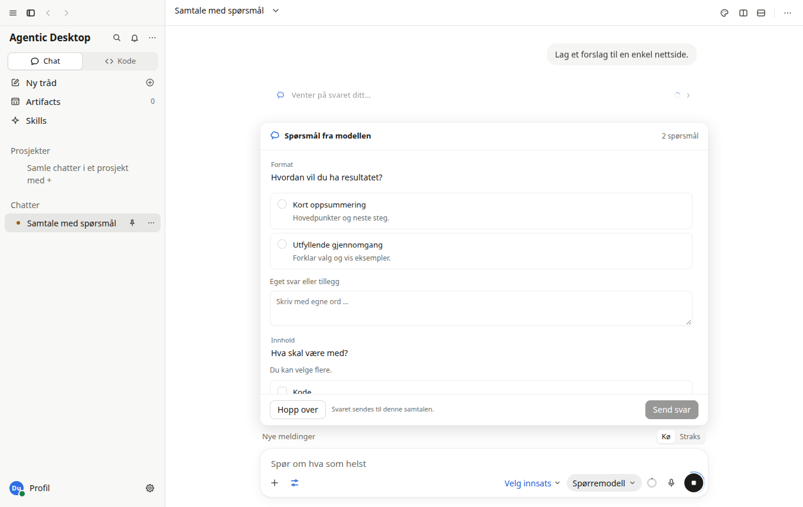

# Spørsmål fra modellen

Modeller kan stille spørsmål i et eget kort over meldingsfeltet.



Modellen kan stille ett til tre spørsmål sammen. Velg ett alternativ, kryss av flere når det er tillatt, eller skriv et eget svar nederst. Du kan også legge fritekst til valgene. Ingen alternativer er valgt på forhånd. **Send svar** fortsetter akkurat kjøringen som stilte spørsmålet; **Hopp over** forteller modellen at du ikke svarte.

Spørsmål virker i Chat og Kode, med og uten prosjektmappe, også i planmodus og hjelpetråder. En hjelpetråds spørsmål besvares i hjelpetråden. Tilgang til spørsmål gir ingen nye fil-, kommando- eller nettverkstillatelser. Vanlige verktøygodkjenninger gjelder fortsatt.

Du kan prøve med demo-modellen ved å sende **Test spørrekort**. Den viser to spørsmål og oppsummerer svaret uten eksterne modellkall.

Du kan bytte samtale mens et spørsmål venter. Delvis utfylte svar beholdes når du kommer tilbake så lenge samtalen ligger i appens minne. Etter gjenlasting hentes selve spørsmålet igjen; usendte svar kan måtte fylles ut på nytt. Et nytt utkast i det vanlige meldingsfeltet sendes ikke sammen med spørresvaret.

Spørsmål og sendte svar inngår i samtalens verktøyhistorikk og kan åpnes igjen i en liten oppsummering. Dette skiller seg fra `/btw`, som er et midlertidig sidespørsmål fra brukeren. Ikke skriv passord eller API-nøkler i spørrekortet.

Stopp, arkivering og omstart lukker ventende spørsmål. Hvis du styrer den aktive turen med en ny melding, lukkes spørsmålet uten svar, også hvis en hook senere stopper meldingen. En vanlig kømelding lukker ikke kortet. Et gammelt svar kan ikke havne i en ny tur eller en annen samtale. Ved en midlertidig sendefeil beholdes svaret, slik at du kan prøve igjen.

## For modeller og integrasjoner

Det kanoniske verktøyet er `request_user_input`; `ask_user` godtas som alias. Modellen må støtte vanlige verktøykall hos den valgte leverandøren. Verktøyet er tilgjengelig uavhengig av valgene for nett, filer og Python.

```json
{
  "questions": [
    {
      "id": "format",
      "header": "Format",
      "question": "Hvordan vil du ha resultatet?",
      "options": [
        { "label": "Kort", "description": "Bare hovedpunktene." },
        { "label": "Utfyllende", "description": "Forklar valg og vis eksempler." }
      ],
      "multiSelect": false
    }
  ]
}
```

Hvert spørsmål trenger en unik `id` og en selvforklarende `question`. `header` og `options` er valgfrie. `multiSelect: true` gir avkryssing; uten alternativer vises bare fritekst. Grensene er tre spørsmål, åtte alternativer per spørsmål og 8 000 tegn fritekst per svar. Alternativnavn må være ulike innenfor spørsmålet.

Svaret returneres til det opprinnelige verktøykallet:

```json
{
  "cancelled": false,
  "answers": [
    { "questionId": "format", "selectedOptions": ["Kort"], "text": "På norsk." }
  ]
}
```

Ved **Hopp over** returneres `{"cancelled":true,"answers":[]}`. Modellen skal respektere dette, og ikke gjenta spørsmålet som om et standardvalg var godkjent. `PreToolUse` kan stoppe spørsmålet før kortet vises. Et vellykket verktøyresultat kan også inneholde et `hookFeedback`-felt fra `PostToolUse`. Verktøyet gir ingen tillatelse til en handling.

Det autentiserte endepunktet `POST /api/threads/:id/questions/:requestId` tar `runId` og svarene. Serveren kontrollerer tråd, kjøring, spørsmåls-ID-er, antall valg, gyldige alternativer og tekstlengde før et svar godtas. Samme spørsmål kan besvares én gang. Spørresvar går som et verktøyresultat, aldri gjennom den vanlige meldingskøen eller `/steer`.
